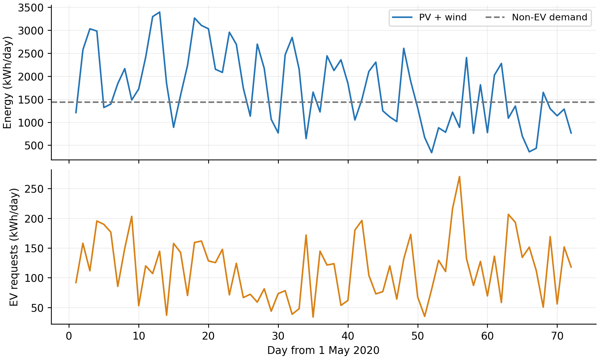
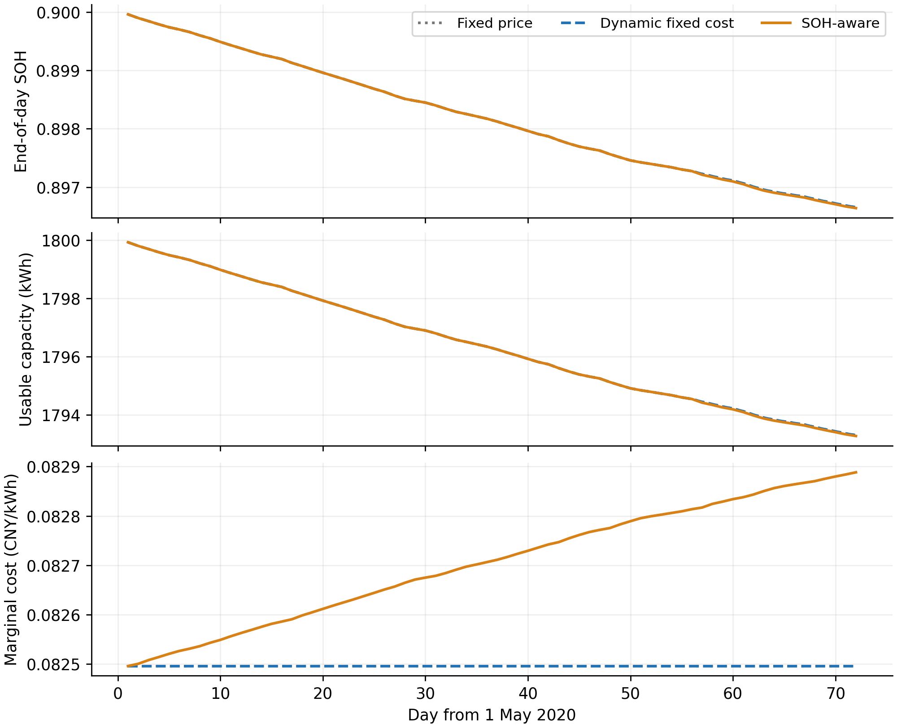

# Integrating Battery State of Health into Rolling Leader-Follower Pricing and Dispatch for an Islanded Highway EV Charging Microgrid

## Abstract

Battery state of health (SOH) changes both available storage capacity and the cost of subsequent operation, yet these effects can be disconnected from charging-price decisions when aging is evaluated only after dispatch. This study introduces an explicit SOH interface into a rolling leader-follower pricing and storage-dispatch framework for an islanded highway electric vehicle (EV) charging microgrid. Health determines the operator's usable-capacity constraint and marginal degradation coefficient, while executed SOC and energy throughput update the health state carried to the next daily decision. A common accounting boundary separates delivered EV revenue, EV and non-EV shortages, renewable curtailment, conversion losses and network losses. The system comprises 400-kW PV, 100-kW wind, a 2000-kWh/800-kW battery, and eight 60-kW charging posts, driven by date-matched EV and ERA5 inputs. Independent-day component ablations and a 72-day accepted continuous replay provide feasibility evidence. The continuous replay maintains consistent state handoffs, delivered-energy revenue and energy identities across 3456 half-hour steps per arm. In the health-aware arm, SOH decreases from 0.900000 to 0.896641, usable capacity decreases from 1800.00 to 1793.28 kWh, and the marginal coefficient increases from 0.082496 to 0.082888 CNY/kWh. These results demonstrate active health feedback and numerical executability over the evaluated domain. The fixed-request experiments isolate the SOH interface; they do not establish strategic price responsiveness, global equilibrium or battery-lifetime benefits.

**Keywords:** battery state of health; leader-follower pricing; storage dispatch; highway charging station; islanded microgrid; delivered-energy accounting

## 1. Introduction

An islanded highway EV charging station must balance renewable generation, charging demand and auxiliary loads without importing electricity. Pricing and energy scheduling are connected: the operator selects tariffs and storage actions, while charging users allocate energy subject to their availability and preferences. Battery operation shifts renewable energy between periods, but also changes the asset's future capability through degradation.

SOH introduces a slower state into this interaction. A degraded battery has less usable energy, and the economic consequence of cycling depends on the adopted health-cost model. Deducting aging only after scheduling cannot transmit these effects to the operator's decision. Conversely, embedding a detailed electrochemical model in every candidate-price evaluation can make repeated optimization burdensome. This motivates a tractable interface between operational pricing and a daily health transition.

Leader-follower pricing [1] and islanded microgrid coordination [2] provide the decision structure. The specific question addressed here is whether SOH can enter that structure as an operational input, with the consequences of executed dispatch consistently returned to subsequent decisions. SOH belongs to the operator's asset state; it does not constitute an additional strategic player. Its influence on the leader passes through available storage energy and marginal degradation cost, while the follower retains a charging-allocation objective.

This study makes three contributions. First, it specifies capacity and cost interfaces that introduce SOH before price and storage scheduling. Second, it links executed SOC and throughput to a daily physical health update with explicit cross-day state transfer. Third, it evaluates this coupling through matched component ablations and continuous energy, revenue and state checks. The contribution is the implemented coupling and its bounded feasibility evidence. The experiments distinguish a functioning health interface from a policy's economic advantage: unchanged service or tariff need not imply that the interface is inactive.

## 2. Related Work

Cheng et al. study personalized network-aware EV pricing using a sequential Stackelberg game [1]. Singh et al. formulate a bi-level Stackelberg approach for islanded DC microgrid coordination with hybrid storage and demand response [2]. These works motivate the leader-follower interaction, but their behavioral and network assumptions do not validate the parameters adopted here. The present study focuses on connecting a slow battery-health state to the operator's repeatedly solved scheduling problem.

Battery design and operation depend on application requirements and degradation mechanisms [4,5]. Cell-specific holistic aging [6], life-assessment models [7], market-oriented cycle-aging costs [8] and calendar-aging studies [9] address complementary aspects of this connection. Here, a marginal throughput proxy is used inside scheduling, while executed trajectories determine the daily health update and common aging account. This separation offers computational convenience, but the proxy remains an engineering model requiring battery-specific calibration.

Receding-horizon control executes the first action and resolves as the state changes. The theory of constrained model predictive control [10] distinguishes such an implementation from established stability or optimality guarantees. Accordingly, this work reports the stopping criteria and acceptance domain of the implemented search, rather than treating a rolling calculation as a proof of equilibrium convergence.

## 3. System and Data

### 3.1. Station boundary and equipment

The station contains PV, wind, a BESS, eight EV charging posts and an assumed constant non-EV load. There is no external electricity import. Renewable surplus can be curtailed, and unmet EV and non-EV demand is recorded separately. A reference-voltage node in the network calculation sets the voltage reference without supplying additional energy.

**Table 1. Station parameters and operating assumptions.**

| Quantity | Value | Interpretation |
|---|---|---|
| PV / wind rating | 400 / 100 kW | Upper bounds on available generation |
| BESS nominal energy / power | 2000 kWh / 800 kW | Constant equipment configuration |
| EV equipment | 8 posts at 60 kW | Aggregate service limit 480 kW |
| Non-EV demand | 60 kW | Assumed constant auxiliary load |
| Continuous initial SOC / SOH | 0.50 / 0.90 | Matched across comparison arms |
| Continuous SOC range | 0.20-0.90 | Planning and execution bounds |
| Terminal SOC minimum | 0.20 | Enforced at the daily horizon end |
| Charging / discharging efficiency | 0.95 / 0.95 | Constant conversion efficiencies |
| Dispatch interval | 0.5 h | 48 executed intervals per day |
| Price levels | 1.5-2.5 CNY/kWh, step 0.2 | Six discrete tariffs |
| Fixed-price reference | 1.5 CNY/kWh | Shared physical equipment |
| EV / non-EV shortage penalty | 100 / 1000 CNY/kWh | Assumed reliability valuations |
| Curtailment penalty | 0.2 CNY/kWh | Held constant across arms |
| Nominal replacement-value reference | 2000000 CNY | 1000 CNY per nominal kWh |

### 3.2. EV demand and temporal alignment

EV activity is based on version 3 of the public Chinese charging-transaction dataset [3], using Site A. The processed hourly series is read from `expressway_hourly_ev_load.csv` and used at its recorded scale, with a demand multiplier of 1.0 in the reported experiments. The eight-post equipment limit is applied separately; it does not multiply the input energy. The station aggregation is a study input convention and is not an independently verified reconstruction of the publisher's physical charger inventory.

Each half-hour interval uses the containing hour's calibrated EV power, so integrated daily requests are unchanged by the half-hour discretization. Within a recorded transaction date, hours absent from the aggregation follow the provider's zero-activity convention. Entire missing dates are not substituted with zero demand. Experiments require available dated EV observations and complete weather boundaries.

The independent-day scenarios select three dates near each of the P10, P50 and P90 daily-energy levels, with at least seven days between dates within a stratum. The eligible input population contains 720 dates with complete weather alignment; the target energies are approximately 73.23, 193.27 and 460.01 kWh/day. The continuous evidence uses the same dated EV and weather inputs across all arms from 1 May to 11 July 2020.

### 3.3. Weather-driven renewable generation

ERA5 hourly reanalysis is aligned to China Standard Time (UTC+8). The 0.25-degree grid point is a spatial proxy, not on-site generation metering. Solar radiation `ssrd` is a one-hour accumulation ending at its validity timestamp. Dispatch during 10:00-11:00 therefore uses the record valid at 11:00. Both half-hour intervals use mean irradiance `G = ssrd/3600` W/m², with available PV power `400 clip(G/1000,0,1)` kW.

Wind speed is derived from the 100-m vector and averaged over the dispatch hour's two boundary samples. Available wind power is zero below 3 m/s or at/above 25 m/s; between 3 and 12 m/s it follows `100 (v^3-3^3)/(12^3-3^3)` kW, capped at 100 kW. PV temperature derating, tilt, turbine-specific calibration, wake and downtime are not represented. The inputs are date-matched physical drivers, not validated forecasts. Continuous scheduling uses the remaining observed trace within the day as a shrinking perfect-information horizon. Figure 1 shows the available supply and demand on the evaluated dates.

**Figure 1.** Daily EV requests, assumed non-EV demand and weather-derived available renewable energy over the 72 evaluated dates. All arms use the same inputs. Weather-to-power conversion is an engineering assumption.

## 4. SOH-Coupled Leader-Follower Model

### 4.1. User response and service constraints

The operator selects a tariff vector p and a storage schedule. Given prices, user group i allocates energy e over its available slots to maximize its charging surplus:

\[
\max_e\;\sum_i\sum_t(v_i-p_t)e_{i,t}. \qquad (1)
\]

Energy is nonnegative, zero outside the availability window, bounded by group power times slot duration, and subject to declared minimum and maximum group energy. The aggregate equipment constraint is

\[
\sum_i e_{i,t}\leq (480-P_{EV,t}^{rigid})_+\Delta t_t. \qquad (2)
\]

This follower permits price-dependent allocation when availability and energy bounds allow alternatives. To isolate the SOH interface in the reported experiments, group energy is fixed to the common requested trace and each group is tied to its own slot; its valuation is 3.0 CNY/kWh, above all offered tariffs. Thus these tests do not identify demand elasticity. In this controlled setting, a tariff revenue difference alone is not evidence of improved customer response.

### 4.2. Storage feasibility and operator objective

Let h be incoming SOH and E_nom nominal battery energy. The health-aware planner uses effective capacity E_nom h. With charging and discharging efficiencies eta_c and eta_d, SOC follows

\[
s_{t+1}=s_t+\frac{(\eta_cP_t^{ch}-P_t^{dis}/\eta_d)\Delta t_t}{E_{nom}h}. \qquad (3)
\]

Charge and discharge are nonnegative, limited to 800 kW, and made mutually exclusive by a binary mode variable. The continuous comparison uses SOC bounds 0.20-0.90 in planning and execution and a terminal minimum of 0.20. The capacity ablation substitutes nominal energy in the planner while preserving the same health-dependent physical asset.

For renewable power r, requested EV power q, non-EV load b, curtailment c and separate EV/non-EV unserved powers u, the planning balance is

\[
r_t+P_t^{dis}+u_t^{EV}+u_t^{N}=b_t+q_t+P_t^{ch}+c_t. \qquad (4)
\]

The operator compares candidate tariffs using delivered-energy revenue and the adopted operating penalties:

\[
J=\sum_t p_t(q_t-u_t^{EV})\Delta t_t-C_{deg}^{proxy}-C_{shed}-C_{curt}. \qquad (5)
\]

The degradation proxy is the marginal coefficient times charge-plus-discharge throughput. Shortage penalties distinguish EV requests from non-EV load. Physical execution accounts for network losses and can adjust the planned first action; realized revenue is therefore calculated from executed delivery. No requested-but-unserved EV energy earns revenue.

### 4.3. Daily physical health and marginal cost

SOH is held fixed during each day. Executed battery power and SOC determine daily throughput Q and SOC range D:

\[
Q_d=\sum_{t\in d}|P_t^{BESS}|\Delta t_t,\quad D_d=\mathrm{clip}(s_{max}-s_{min},0.01,1). \qquad (6)
\]

Daily health loss is

\[
\Delta h_d=\frac{k_{cal}(\bar s_d)}{365}\frac{H_d}{24}+\gamma Q_dD_d^{\alpha-1}. \qquad (7)
\]

Here gamma=1.5e-8/kWh, alpha=1.5 and H_d is the executed duration in hours. Annual calendar coefficients are 0.01, 0.015, 0.025 and 0.04 for average SOC in 0.10-0.50, above 0.50-0.80, above 0.80-0.90 and above 0.90-1.00, respectively. The full battery-group state is updated at the daily boundary. Health loss changes the usable capacity passed to the next solve.

The single-group marginal cycling coefficient uses reference DOD 0.5 and nominal replacement-value reference C_ref=2000000 CNY:

\[
c_{deg}(h)=\frac{C_{ref}\gamma(0.5)^{\alpha-1}}{0.30}\left[1+0.5\left(1-\frac{h-0.70}{0.30}\right)\right]. \qquad (8)
\]

Health is clipped to 0.70-1.00 for this coefficient. The residual-value derivative is 1/0.30, and the bracketed term is an explicit, provisional low-health wear multiplier. These are modeling assumptions, not cell-specific measurements. C_ref is based on nominal equipment and is not reduced again with usable capacity. The continuous fixed-cost baseline freezes the common initial coefficient, 0.082495791 CNY/kWh at SOH 0.90; the health-aware coefficient is refreshed daily.

Trajectory aging is evaluated from executed states using the same valuation for every arm and deducted once. A health-triggered replacement is accounted separately from operating value. No replacement occurs in the continuous 72-day comparison.

### 4.4. Physical execution and accounting

The execution layer clips commands to battery limits, calculates losses in an assumed resistive DC network, and rebalances service and curtailment. The prototype uses a 0.4-kV reference and three 0.005-ohm branches connecting storage to PV, wind and load buses. During a deficit, feasible discharge is increased before flexible EV service is reduced; remaining non-EV shortages are recorded. Surplus is curtailed from PV and then wind before excess battery charging is adjusted.

Battery conversion loss is

\[
L_{bat}=\sum_t\left[(1-\eta_c)P_t^{ch}+(1/\eta_d-1)P_t^{dis}\right]\Delta t_t. \qquad (9)
\]

With P_EV,served denoting executed EV delivery power, revenue is

\[
R_{EV}=\sum_t p_tP_{EV,served,t}\Delta t_t. \qquad (10)
\]

For the executed daily trajectory, the energy identity is

\[
E_{RE}=E_{EV,served}+E_{N,served}+E_{curt}+L_{bat}+L_{net}+\Delta E_{stored}. \qquad (11)
\]

When SOH changes at the boundary, stored-energy revaluation is recorded separately from conversion and network losses. The modeled operating value is delivered EV revenue minus trajectory aging, EV and non-EV shortage penalties, and curtailment penalty. These reliability valuations are not measured cash expenses. Reporting curtailment together with battery and network losses prevents a reduction in curtailment from being mistaken for useful energy delivery.

## 5. Rolling Solution Procedure

### 5.1. Algorithm: health-dependent pricing and dispatch

The coupling has three links: incoming health parameterizes capacity and marginal cost; the leader evaluates tariffs using those parameters and the follower response; executed dispatch updates the health state supplied to the next day. A post-hoc aging deduction alone does not implement this loop.

**Inputs:** dated EV/weather traces, equipment ratings, tariff levels, cost assumptions, initial SOC and complete battery state, and numerical acceptance tolerances. **Outputs:** executed tariffs, delivery and shortage by load class, battery actions, updated SOC/SOH, energy and cost ledgers.

1. At the daily boundary, receive the previous day's full battery state and SOC. Compute usable capacity and the SOH-dependent marginal coefficient; the fixed-cost baseline retains its initial coefficient.

2. At each half-hour, form the remaining daily horizon. Initialize the tariff vector and evaluate the follower LP and storage/service MILP.

3. Scan the tariff coordinates. For each coordinate, evaluate the six allowed prices through the same follower and leader problems, retaining an improvement in objective value. Record objective changes and the number of sweeps.

4. Apply the declared stopping rule. Execute only the first half-hour action through the physical layer and record delivered EV revenue, separate shortages, losses, curtailment and SOC.

5. At day end, calculate trajectory aging, update the full health state, record any capacity revaluation and replacement, and pass the updated state to the next date.

6. Accept an experimental trajectory only when its declared energy, SOC and search criteria hold. Use matched accepted records for comparative totals and preserve the full record set in the reproducibility package.

The continuous implementation permits two coordinate sweeps and accepts an absolute final-sweep objective difference at most 1e-6 CNY. The independent-day component experiment permits three complete sweeps. Pyomo and HiGHS through appsi solve the LP/MILP subproblems. The stopping test describes the implemented bounded search; it is not a certificate of global Stackelberg optimality.

### 5.2. Mechanism separation

The capacity switch controls whether planning uses nominal energy or health-reduced energy, with physical health fixed across each matched comparison. The cost switch controls whether the marginal coefficient can be refreshed from health. Because health is fixed within an independent day and initial coefficients are matched, the cost switch is expected to produce no within-day difference. Its active effect is tested through continuous daily state updates. This design distinguishes interface verification from a requirement that every switch change the final delivered energy.

## 6. Experimental Design

### 6.1. Component and continuous comparisons

The component experiment crosses P10/P50/P90 demand, three selected dates per stratum, initial SOH 1.00/0.90/0.80/0.70, and the four combinations of capacity and cost switches, giving 144 cases. Initial SOC is 0.50, dispatch is half-hourly, and source traces are matched within each factor comparison. Physical health remains constant during the day and is updated at the boundary. Each date is independently initialized, so this experiment diagnoses planning interfaces rather than continuous lifetime behavior.

The continuous comparison includes fixed price+BESS, dynamic price with a fixed degradation coefficient, and SOH-aware dynamic pricing. All use the same dated requests and weather, initial SOC 0.50 and SOH 0.90, health-dependent physical capacity, reserve/terminal rules, and cost accounting. Both dynamic arms use the same health-dependent planning capacity; their difference is refreshed versus frozen marginal cost and its resulting state-path effects. The compared accepted period is 1 May-11 July 2020, or 72 consecutive days.

### 6.2. Acceptance and evaluation metrics

The absolute daily energy-identity tolerance is 1e-6 kWh. SOC, state transitions and the declared search stopping test are checked before inclusion. Of 144 component cases, 136 meet all criteria; eight energy-gate exclusions are retained in the underlying record set. The accepted continuous comparison contains 3456 half-hour steps per arm.

Metrics are absolute EV delivery, EV and non-EV shortage, realized revenue, curtailment, battery and network losses, trajectory aging, modeled operating value and recorded runtime. Paired differences use the same dates and inputs. The selected component dates are purposive scenarios, and the continuous period is one chronological path; neither is treated as an independent population sample for a confidence interval. Economic uncertainty is assessed by explicitly varying the non-EV shortage valuation on the same physical outcomes.

## 7. Results

### 7.1. Capacity and cost interfaces

The accepted component results provide 66 matched capacity-switch pairs and 68 matched cost-switch pairs. Capacity feedback changes planned BESS power by up to 250.31 kW and executed BESS power by up to 246.27 kW. In 28 pairs, different plans are mapped to identical executed actions by the physical rebalancing layer. The largest absolute EV-delivery difference across the capacity pairs is below 1.2e-13 kWh. Thus planning capacity is an active interface, but its effect need not appear as additional EV service under the tested requests.

Cost-switch pairs have zero executed-action and trajectory-aging differences. This agrees with the matched initial coefficient and constant within-day health. The result motivates testing cost refresh at daily boundaries rather than interpreting an independent-day null result as evidence that the health interface is inactive.

### 7.2. Continuous health feedback

In the SOH-aware path, health decreases from 0.900000000 to 0.896640771. Usable battery capacity falls from 1800.0000 to 1793.2815 kWh. The daily marginal coefficient increases from 0.082495791 to 0.082888297 CNY/kWh, while the matched dynamic baseline retains 0.082495791 CNY/kWh. The recorded coefficient agrees with Equation (8) within 2.78e-17 CNY/kWh. Figure 2 shows the three quantities directly.

**Figure 2.** Recorded daily health, usable capacity and planning marginal coefficient over the 72 evaluated days. All arms carry physical health; only the SOH-aware arm refreshes the marginal coefficient. Closely overlapping health and capacity curves do not imply equal cost coefficients.

All adjacent daily full-state and SOC handoffs are consistent. Incoming usable capacity equals 2000 times SOH, and each revenue entry equals executed price times delivered EV kWh. These checks establish that health is used by subsequent scheduling and that realized outcomes are accounted on a common boundary.

### 7.3. Service, losses and modeled value

Table 2 reports matched totals for all three arms. EV delivery and unmet EV energy are the same to the stated precision. The two dynamic arms also have identical delivered-energy revenue. Their price revenue differs from fixed pricing on a common rigid request trace; this difference does not identify a behavioral benefit from dynamic pricing.

**Table 2. Matched 72-day totals. Monetary values are CNY and energy values are kWh unless indicated.**

| Metric | Fixed price | Dynamic fixed cost | SOH-aware |
|---|---:|---:|---:|
| EV requested energy (kWh) | 8,359.71 | 8,359.71 | 8,359.71 |
| EV delivered energy (kWh) | 7,406.38 | 7,406.38 | 7,406.38 |
| Unserved EV energy (kWh) | 953.33 | 953.33 | 953.33 |
| Unserved non-EV energy (kWh) | 13,556.61 | 13,560.66 | 13,548.84 |
| Delivered EV revenue (CNY) | 11,109.57 | 17,631.69 | 17,631.69 |
| Trajectory aging cost (CNY) | 22,301.76 | 22,300.82 | 22,394.86 |
| Renewable curtailment (kWh) | 22,691.35 | 22,695.38 | 22,682.16 |
| Battery conversion loss (kWh) | 4,571.79 | 4,571.35 | 4,572.63 |
| Network loss (kWh) | 712.72 | 713.18 | 713.29 |
| Curtailment plus losses (kWh) | 27,975.86 | 27,979.91 | 27,968.08 |
| Modeled operating value (CNY) | -13,667,668.17 | -13,665,199.25 | -13,653,476.31 |
| Recorded elapsed time (s) | 441.58 | 160,570.63 | 160,701.28 |

SOH-aware minus dynamic fixed cost is -11.81 kWh non-EV shortage, -11.83 kWh curtailment plus conversion/network loss, and +94.04 CNY trajectory aging. The modeled operating-value difference is +11722.94 CNY. This difference is primarily the avoided non-EV shortage multiplied by the assumed 1000 CNY/kWh reliability penalty; the modeled operating totals remain negative. It is not a measured cash-profit improvement.

**Table 3. Sensitivity of the paired operating-value difference to non-EV shortage valuation. Physical trajectories remain unchanged.**

| Non-EV shortage valuation (CNY/kWh) | SOH-aware minus dynamic fixed cost (CNY) |
|---|---:|
| 0 | -91.39 |
| 5 | -32.32 |
| 10 | 26.75 |
| 100 | 1090.04 |
| 1000 | 11722.94 |

The break-even valuation is approximately 7.74 CNY/kWh. The sensitivity supports interpreting the comparison as a conditional reliability-cost trade-off, rather than using an assumed penalty to establish general economic superiority.

### 7.4. Numerical execution and computation

Each accepted dynamic path contains 3456 half-hour records with SOC within 0.20-0.90 and no terminal-SOC feasibility failure. The maximum absolute daily energy residual is 2.33e-10 kWh, below the declared tolerance. A prototype network reconstruction gives voltages of 0.99623-1.01219 pu within the assumed 0.95-1.05 pu band. Branch ampacity data are unavailable, so this is a voltage-only model check.

Recorded times are 441.58 s for fixed price, 160570.63 s for dynamic fixed cost and 160701.28 s for SOH-aware over the matched period. The health-aware dynamic run adds 130.65 s to the dynamic fixed-cost run. Host pauses and concurrent workloads affect these elapsed-time records; they do not constitute a controlled processor benchmark. The evidence demonstrates offline execution, without establishing real-time deployment performance.

## 8. Discussion

The results support a specific feasibility conclusion: SOH can parameterize the operator's storage constraints and marginal cost, and executed decisions can update the state used in later solves without breaking energy or revenue accounting. Component ablations verify the capacity channel, and continuous replay verifies cross-day cost refresh. This is stronger evidence of an implemented interface than merely reporting an SOH column or subtracting an aging estimate after scheduling.

The distinction between interface activity and performance improvement is essential. Capacity-induced planning differences can be absorbed by execution adjustments, while a small cost change may leave discrete prices or useful delivery unchanged. The observed non-EV shortage reduction accompanies higher aging cost and depends economically on the adopted reliability valuation. The study therefore evaluates the SOH coupling on its actual function and does not require uniform service or profit gains.

The demonstrated domain remains limited. The accepted continuous period is a 72-day prefix of a planned 90-day evaluation; both dynamic arms encounter the search stopping limit on the following day, so reliable full-window completion is not established. Fixed per-slot user requests isolate the health interface but do not validate strategic price responsiveness or equilibrium. The daily aging proxy lacks chemistry and temperature calibration; the ERA5 grid point and prototype network are spatial and engineering assumptions, and thermal ratings are absent. These limits restrict the conclusion to numerical feasibility under the specified model, rather than measured lifetime extension, uninterrupted service or field safety.

## 9. Conclusions

A capacity-and-cost interface has been developed to incorporate battery SOH into rolling leader-follower EV pricing and storage dispatch. Incoming health determines usable energy and marginal degradation cost before scheduling; executed SOC and throughput update the full battery state carried to the next daily decision.

Accepted component ablations and a 72-day continuous comparison demonstrate active capacity/cost feedback, consistent state transfer, delivered-energy revenue and closed energy accounting. The continuous SOH-aware path reduces usable capacity from 1800.00 to 1793.28 kWh and increases the marginal coefficient from 0.082496 to 0.082888 CNY/kWh as health changes. EV delivery remains unchanged relative to the matched dynamic baseline, and the modeled-value difference is conditional on the shortage valuation. The evidence establishes implementation feasibility over the evaluated domain; robust responsive-game convergence, calibrated lifetime benefits and deployment performance require further validation.

## Data and Code Availability

Charging transactions are available from Figshare version 3 [3] under CC BY 4.0. The reproducibility package retains dated input provenance, model parameters, component records, continuous half-hour ledgers, source hashes, audit scripts and figure-generation code. Accepted samples and exclusion records are identifiable separately. The package is maintained locally and is not currently a public code release.

## References

[1] Cheng, Rui; Liu, Gengming; Liu, Wenxia; Shi, Qingxin; Chen, Qifang. A personalized network-aware price design for electric vehicle charging using a sequential Stackelberg game. Applied Energy 2025, 381, 125145. DOI: 10.1016/j.apenergy.2024.125145.

[2] Singh, Abhishek; Kumar, Alok; K.A., Chinmaya; Maulik, Avirup. DC microgrid operation with hybrid energy storage considering islanding constraints and demand response coordination: A bi-level Stackelberg game approach. Journal of Energy Storage 2024, 102, 113913. DOI: 10.1016/j.est.2024.113913.

[3] Yuanshi Zhang; Tongxin Xu; Tao Chen; Qinran Hu; Hongrui Chen; Xukun Hu; Zilv Jiang. A high-resolution electric vehicle charging transaction dataset with multidimensional features in China. Figshare, version 3, 2025. DOI: 10.6084/m9.figshare.28182251.v3. CC BY 4.0.

[4] Hesse, Holger; Schimpe, Michael; Kucevic, Daniel; Jossen, Andreas. Lithium-Ion Battery Storage for the Grid—A Review of Stationary Battery Storage System Design Tailored for Applications in Modern Power Grids. Energies 2017, 10, 2107. DOI: 10.3390/en10122107.

[5] Vetter, J.; Novák, P.; Wagner, M.R.; Veit, C.; Möller, K.-C.; Besenhard, J.O.; Winter, M.; Wohlfahrt-Mehrens, M.; Vogler, C.; Hammouche, A. Ageing mechanisms in lithium-ion batteries. Journal of Power Sources 2005, 147, 269-281. DOI: 10.1016/j.jpowsour.2005.01.006.

[6] Schmalstieg, Johannes; Käbitz, Stefan; Ecker, Madeleine; Sauer, Dirk Uwe. A holistic aging model for Li(NiMnCo)O2 based 18650 lithium-ion batteries. Journal of Power Sources 2014, 257, 325-334. DOI: 10.1016/j.jpowsour.2014.02.012.

[7] Xu, Bolun; Oudalov, Alexandre; Ulbig, Andreas; Andersson, Goran; Kirschen, Daniel S. Modeling of Lithium-Ion Battery Degradation for Cell Life Assessment. IEEE Transactions on Smart Grid 2018, 9, 1131-1140. DOI: 10.1109/tsg.2016.2578950.

[8] Xu, Bolun; Zhao, Jinye; Zheng, Tongxin; Litvinov, Eugene; Kirschen, Daniel S. Factoring the Cycle Aging Cost of Batteries Participating in Electricity Markets. IEEE Transactions on Power Systems 2018, 33, 2248-2259. DOI: 10.1109/tpwrs.2017.2733339.

[9] Keil, Peter; Schuster, Simon F.; Wilhelm, Jörn; Travi, Julian; Hauser, Andreas; Karl, Ralph C.; Jossen, Andreas. Calendar Aging of Lithium-Ion Batteries. Journal of The Electrochemical Society 2016, 163, A1872-A1880. DOI: 10.1149/2.0411609jes.

[10] Mayne, D.Q.; Rawlings, J.B.; Rao, C.V.; Scokaert, P.O.M. Constrained model predictive control: Stability and optimality. Automatica 2000, 36, 789-814. DOI: 10.1016/s0005-1098(99)00214-9.
