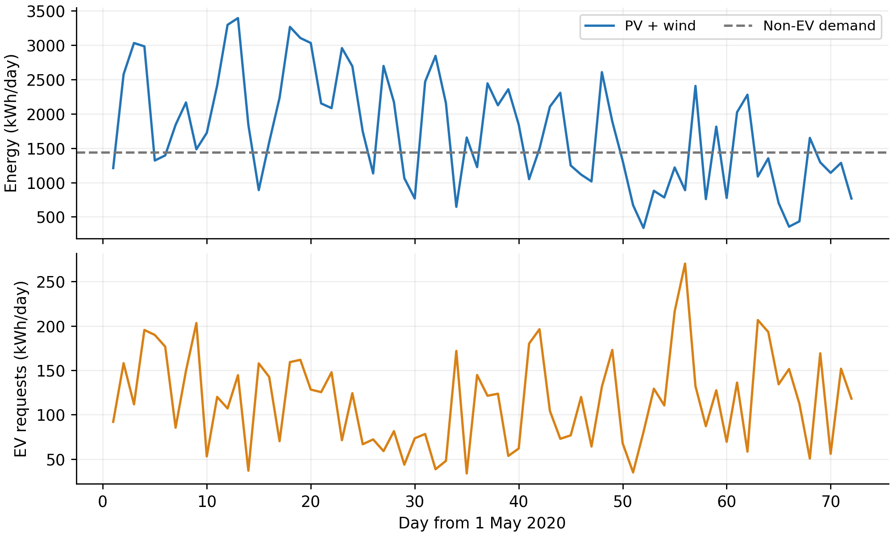
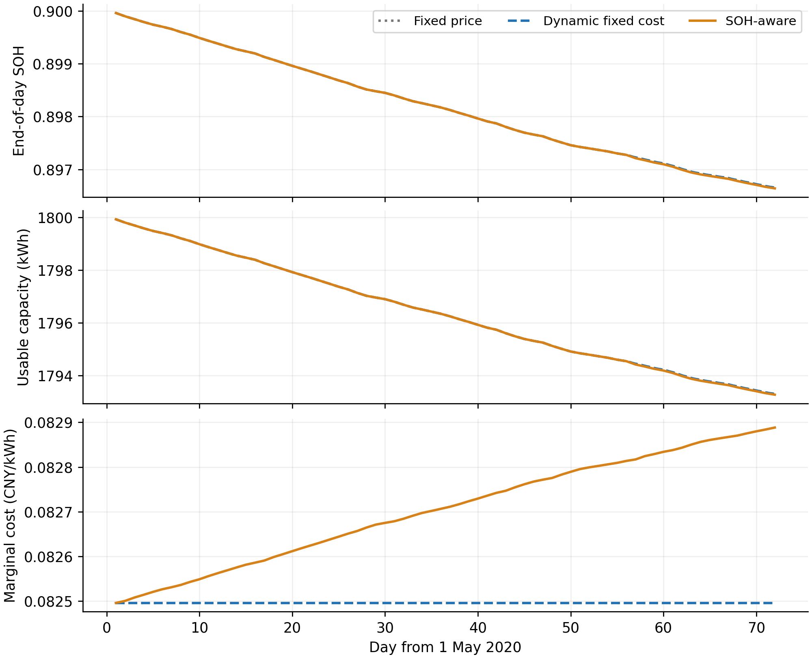

# 将电池SOH纳入高速公路孤岛充电微电网的滚动主从定价与调度

## 摘要

电池健康状态（SOH）同时影响储能可用容量与后续运行成本，仅在调度后核算老化容易使这些影响与充电定价决策脱节。本文在高速公路孤岛电动汽车充电微电网的滚动主从定价与储能调度框架中，引入明确的SOH接口：健康状态决定运营者的可用容量约束与边际退化系数，执行SOC和电量吞吐更新传递至下一日的健康状态；共同核算边界分别计量实际交付收入、EV与非EV缺供、可再生弃电、电池及网络损耗。系统配置为400 kW光伏、100 kW风电、2000 kWh/800 kW储能及8个60 kW充电桩，采用日期匹配的EV与ERA5输入。独立日组件消融和通过接受条件的72天连续回放提供可行性证据。连续比较每组3456个半小时记录的状态传递、交付收入与能量恒等式保持一致。SOH-aware组健康由0.900000降至0.896641，可用容量由1800.00降至1793.28 kWh，边际系数由0.082496升至0.082888元/kWh，表明健康反馈实际生效，方法在评价范围内具有数值可执行性。固定请求实验用于隔离SOH接口，不能据此推断策略性电价响应、全局均衡或电池寿命收益。

**关键词：** 电池健康状态；主从定价；储能调度；高速公路充电站；孤岛微电网；实际交付电量核算

## 1. 引言

孤岛型高速公路EV充电站无法从外部电网购电，需要联合平衡可再生发电、充电需求和辅助负荷。运营者选择电价与储能动作，充电用户依据可用时段及偏好分配电量，两类决策相互关联。电池可以跨时段转移可再生能量，但运行老化也会改变未来的供能能力。

SOH在该交互中引入慢状态：健康下降减少可用电量，循环运行的经济后果也取决于健康成本模型。仅在调度后扣除老化不能将上述影响传回运营决策；每次候选电价评价均嵌入细致电化学模型，又会增加重复优化负担。因此需要连接运行层定价与日尺度健康转移的可计算接口。

主从定价[1]和孤岛微电网协调[2]提供决策结构。本文研究SOH能否作为运行输入进入该结构，并将执行后果一致反馈至后续决策。SOH属于运营者的资产状态，并非新增博弈主体；它通过可用储能及边际退化成本影响领导者，跟随者仍优化充电分配。

贡献包括三方面：首先，明确在定价和储能调度前接入SOH的容量与成本接口；其次，将执行SOC与吞吐量连接至日尺度物理健康更新及跨日状态传递；最后，使用匹配组件消融和连续能量、收入及状态检查评价耦合。贡献在于已实现的接口及限定范围可行性证据。接口是否生效与策略是否增利分别评价，服务或电价不变并不直接表示SOH接口无效。

## 2. 相关研究

Cheng等利用顺序Stackelberg博弈研究个性化网络感知EV定价[1]，Singh等采用双层Stackelberg方法协调孤岛直流微电网、混合储能与需求响应[2]。这些研究提供主从交互背景，但不能验证本文采用的行为及网络参数。本文关注如何把慢速电池健康状态接入运营者反复求解的调度问题。

电池设计和运行依赖应用要求与退化机理[4,5]。电芯整体老化模型[6]、寿命评估[7]、市场循环老化成本[8]及日历老化[9]分别处理不同方面。本文在调度内使用边际吞吐代理项，根据执行轨迹更新日健康并统一核算老化。该分离便于计算，但代理模型仍需电池专属校准。

滚动时域控制只执行首个动作，并随状态变化重新求解。约束模型预测控制理论[10]区分这种实现方式与已经证明的稳定性或最优性。本文据此明确报告实际搜索停止条件与接受范围，不将滚动计算本身视为均衡收敛证明。

## 3. 系统与数据

### 3.1. 站点边界与设备

系统由光伏、风电、BESS、8个EV充电桩及假设的恒定非EV负荷构成，无外部电力输入。可再生盈余允许弃用，EV与非EV未服务量分别记录。网络参考电压节点只设置电压基准，不提供额外能量。

**表1. 站点参数与运行假设。**

| 参数 | 数值 | 解释 |
|---|---|---|
| 光伏/风电额定功率 | 400 / 100 kW | 可用发电功率上限 |
| BESS额定电量/功率 | 2000 kWh / 800 kW | 设备配置固定 |
| EV设备 | 8桩，每桩60 kW | 服务总功率上限480 kW |
| 非EV负荷 | 60 kW | 假设恒定辅助负荷 |
| 连续实验初始SOC/SOH | 0.50 / 0.90 | 各比较组一致 |
| 连续实验SOC范围 | 0.20-0.90 | 规划与执行边界 |
| 终端SOC最低值 | 0.20 | 每日日内时域结束约束 |
| 充电/放电效率 | 0.95 / 0.95 | 恒定转换效率 |
| 调度间隔 | 0.5 h | 每日执行48步 |
| 电价档位 | 1.5-2.5元/kWh，步长0.2 | 六档离散电价 |
| 固定电价参考 | 1.5元/kWh | 共用物理设备 |
| EV/非EV缺供罚值 | 100 / 1000元/kWh | 假设可靠性估值 |
| 弃电罚值 | 0.2元/kWh | 各组一致 |
| 额定置换价值参考 | 2000000元 | 每额定kWh价值1000元 |

### 3.2. EV需求与时间对齐

EV活动来自中国公开充电交易数据集第3版[3]，选用Site A。实验读取处理后的`expressway_hourly_ev_load.csv`小时序列，按记录的原始尺度使用，需求倍率为1.0。8桩设备功率约束另行施加，不再将输入电量乘以8。站点聚合属于研究输入约定，并非对数据发布者物理充电桩清单的独立重建。

半小时区间使用所属小时的校准EV功率，因此时间离散化不改变日请求积分。已有交易日期内未出现在聚合表中的小时，沿用数据接口的零活动约定；整日缺失不会替换为零需求。实验要求存在相应日期EV观测及完整气象边界。

独立日情景在P10、P50、P90日能量水平附近各选3个日期，同分层日期至少相隔7天。具有完整气象对齐的可用输入总体含720个日期，目标电量约73.23、193.27、460.01 kWh/日。连续评价区间为2020年5月1日至7月11日，各组使用相同日期EV与气象输入。

### 3.3. 气象驱动可再生发电

小时ERA5再分析数据按中国标准时间UTC+8对齐。0.25度网格点是空间代理，不是站点实测发电。太阳辐射`ssrd`为截至有效时间的一小时累积量，因此10:00-11:00调度使用11:00有效记录，两次半小时共享`G = ssrd/3600` W/m²平均辐照度，可用光伏功率为`400 clip(G/1000,0,1)` kW。

风速由100 m矢量获得，取调度小时两个边界样本均值。低于3 m/s或不低于25 m/s时风电为零；3-12 m/s时按`100 (v^3-3^3)/(12^3-3^3)` kW变化，上限100 kW。未计光伏温度降额、倾角、特定风机校准、尾流和停机。上述输入是日期匹配物理驱动，并非经验证预测。连续调度将当天剩余观测轨迹作为逐步缩短的完全信息时域。图1展示评价日期的可用供给与需求。

**图1.** 72个评价日期的EV请求、假设非EV负荷及气象转换可再生电量。各组共用输入，气象-出力转换采用工程假设。

## 4. SOH耦合主从模型

### 4.1. 用户响应与服务约束

运营者选择电价向量p和储能计划。给定电价，用户组i在可用时隙分配电量e，最大化充电剩余价值：

\[
\max_e\;\sum_i\sum_t(v_i-p_t)e_{i,t}. \qquad (1)
\]

电量非负、窗口外为零，受组功率与时长乘积限制，并满足声明的组电量上下限。共享设备约束为：

\[
\sum_i e_{i,t}\leq (480-P_{EV,t}^{rigid})_+\Delta t_t. \qquad (2)
\]

可用窗口与能量边界允许替代选择时，跟随者可产生电价相关分配。为隔离SOH接口，本文实验将组电量固定为共同请求轨迹，每组绑定所属时隙，估值3.0元/kWh高于全部报价。因此实验不识别需求弹性；共同刚性请求下的收入差异不能解释为用户响应改善。

### 4.2. 储能可行域与运营者目标

h为输入SOH，E_nom为额定电量，健康感知规划使用有效容量E_nom h。充放电效率为eta_c、eta_d，SOC转移为：

\[
s_{t+1}=s_t+\frac{(\eta_cP_t^{ch}-P_t^{dis}/\eta_d)\Delta t_t}{E_{nom}h}. \qquad (3)
\]

充放电非负、上限800 kW，通过二进制模式互斥。连续比较规划与执行SOC均为0.20-0.90，终端最低0.20。容量消融在规划中使用额定电量，物理执行仍保留相同健康相关资产。

可再生功率r、EV请求q、非EV负荷b、弃电c和分类缺供u满足规划平衡：

\[
r_t+P_t^{dis}+u_t^{EV}+u_t^{N}=b_t+q_t+P_t^{ch}+c_t. \qquad (4)
\]

运营者依据交付收入和运行罚项比较候选电价：

\[
J=\sum_t p_t(q_t-u_t^{EV})\Delta t_t-C_{deg}^{proxy}-C_{shed}-C_{curt}. \qquad (5)
\]

退化代理为边际系数乘以充放电总吞吐量，EV与非EV缺供分别赋值。物理执行计入网络损耗并可调整首个规划动作，因此实际收入以执行交付计算。请求但未交付的EV电量不获得收入。

### 4.3. 日尺度物理健康与边际成本

SOH在日内固定。执行电池功率和SOC决定每日吞吐量Q与SOC极差D：

\[
Q_d=\sum_{t\in d}|P_t^{BESS}|\Delta t_t,\quad D_d=\mathrm{clip}(s_{max}-s_{min},0.01,1). \qquad (6)
\]

每日健康损失为：

\[
\Delta h_d=\frac{k_{cal}(\bar s_d)}{365}\frac{H_d}{24}+\gamma Q_dD_d^{\alpha-1}. \qquad (7)
\]

gamma=1.5e-8/kWh、alpha=1.5，H_d为执行小时数。平均SOC位于0.10-0.50、超过0.50至0.80、超过0.80至0.90、超过0.90至1.00时，年度日历系数分别0.01、0.015、0.025、0.04。完整电池组状态在日边界更新，健康损失改变下一次求解的可用容量。

单电池组边际循环系数采用参考DOD=0.5和额定置换价值C_ref=2000000元：

\[
c_{deg}(h)=\frac{C_{ref}\gamma(0.5)^{\alpha-1}}{0.30}\left[1+0.5\left(1-\frac{h-0.70}{0.30}\right)\right]. \qquad (8)
\]

系数中健康截断至0.70-1.00，残值导数为1/0.30，方括号为明确的暂定低健康磨损乘数，均属于模型假设而非电芯专属测量。C_ref依据额定设备，不随可用容量再次缩减。连续固定成本基准冻结共同初始系数，在SOH=0.90时为0.082495791元/kWh；健康感知组每日刷新。

各组均按同一价值标准评价执行轨迹老化且只扣除一次。健康触发的置换与运行价值分开核算。72天连续比较未发生置换。

### 4.4. 物理执行与核算

执行层按电池边界截断指令，在假设电阻型直流网络计算损耗并重平衡服务和弃电。原型采用0.4 kV参考及连接储能与光伏、风电、负荷母线的三条0.005 Ω支路。缺口时先增加可行放电，再削减柔性EV服务，记录剩余非EV缺供；盈余时先弃光、再弃风，随后调整过量电池充电。

电池转换损耗为：

\[
L_{bat}=\sum_t\left[(1-\eta_c)P_t^{ch}+(1/\eta_d-1)P_t^{dis}\right]\Delta t_t. \qquad (9)
\]

以P_EV,served表示实际EV交付功率，收入为：

\[
R_{EV}=\sum_t p_tP_{EV,served,t}\Delta t_t. \qquad (10)
\]

每日执行轨迹的能量恒等式为：

\[
E_{RE}=E_{EV,served}+E_{N,served}+E_{curt}+L_{bat}+L_{net}+\Delta E_{stored}. \qquad (11)
\]

日边界SOH变化时，储能容量重估与转换及网络损耗分开记录。模型运行价值等于EV交付收入减轨迹老化、EV/非EV缺供及弃电罚项；可靠性估值不等于实测现金支出。联合报告弃电与电池、网络损耗，避免把弃电降低误作有用交付增加。

## 5. 滚动求解方法

### 5.1. 算法：健康相关定价与调度

耦合包含三个连接：输入健康参数化容量和边际成本；领导者结合这些参数与跟随者响应评价电价；执行调度更新传递至下一日的健康状态。仅在事后扣除老化不能实现该闭环。

**输入：** 日期匹配EV/气象轨迹、设备容量、电价档位、成本假设、初始SOC与完整电池状态及数值接受容差。**输出：** 执行电价、分类交付与缺供、储能动作、更新SOC/SOH及能量成本账本。

1. 日边界接收前日完整电池状态和SOC，计算可用容量及SOH边际系数；固定成本基准保留初始系数。

2. 每半小时构建当日剩余时域，初始化电价向量，求解跟随者LP与储能/服务MILP。

3. 扫描电价坐标，每个坐标按相同跟随者和领导者问题评价六档电价，保留目标改善，记录目标变化和扫描轮数。

4. 按声明停止规则结束搜索，只经物理层执行首个半小时动作，记录实际EV收入、分类缺供、损耗、弃电及SOC。

5. 日末计算轨迹老化、更新完整健康状态、记录容量重估与置换，并将状态传至下一日期。

6. 仅在能量、SOC与搜索判据满足时接受实验轨迹，以匹配的通过记录计算比较总量，完整记录保留于复现资料。

连续实现允许两轮坐标扫描，末轮目标绝对差不超过1e-6元时接受；独立日组件实验允许三轮完整扫描。LP/MILP通过Pyomo和appsi调用HiGHS。停止判据描述实际有限搜索，不构成全局Stackelberg最优证明。

### 5.2. 机制分离

容量开关决定规划使用额定电量还是健康折减电量，同一匹配对保留相同物理健康。成本开关决定边际系数是否可由健康刷新。因独立日内健康固定且初始系数匹配，成本开关预计不会产生当日差异；其生效通过连续日状态更新检验。由此区分接口验证与“每个开关必须改变最终交付量”的要求。

## 6. 实验设计

### 6.1. 组件与连续比较

组件实验交叉P10/P50/P90需求、每层3个日期、初始SOH 1.00/0.90/0.80/0.70及容量/成本开关四种组合，共144例。初始SOC=0.50，半小时调度，同一因素比较匹配源轨迹。日内物理健康固定，日边界更新。各日期独立初始化，因此检验规划接口，不用于连续寿命推断。

连续比较包含固定电价+BESS、动态电价+固定退化系数、SOH-aware动态定价。各组共享日期请求与气象、初始SOC=0.50和SOH=0.90、健康相关物理容量、储备/终端规则及成本核算。两个动态组规划容量均随健康变化，区别在于边际系数刷新或冻结及后续状态路径影响。比较的连续通过区间为2020年5月1日至7月11日，共72天。

### 6.2. 接受条件与评价指标

每日能量恒等式绝对容差1e-6 kWh，纳入前检查SOC、状态转移和声明的搜索停止条件。144例组件实验中136例全部通过，8例因能量门槛排除，原记录保留。连续比较每组包含3456个半小时通过记录。

指标为绝对EV交付、EV和非EV缺供、实际收入、弃电、电池与网络损耗、轨迹老化、模型运行价值及记录耗时。配对差采用相同日期与输入。组件日期为有目的情景，连续区间是一条时间路径，均不作为独立总体样本给出置信区间。经济不确定性通过在相同物理结果上改变非EV缺供估值评价。

## 7. 结果

### 7.1. 容量与成本接口

通过的组件结果形成66对容量开关与68对成本开关比较。容量反馈使规划BESS功率最大变化250.31 kW、执行功率最大变化246.27 kW。28对中，物理重平衡将不同计划映射为相同执行动作。容量配对EV交付绝对差均低于1.2e-13 kWh。因此容量接口实际生效，但在测试请求下不必表现为额外EV服务。

成本配对执行动作和轨迹老化差异为零，符合初始系数匹配与日内健康固定的设计。由此应在日边界检验成本刷新，而非将独立日零差异视为健康接口未生效。

### 7.2. 连续健康反馈

SOH-aware路径健康由0.900000000降至0.896640771，可用容量由1800.0000降至1793.2815 kWh。每日边际系数由0.082495791升至0.082888297元/kWh，匹配动态基准保持0.082495791元/kWh。记录系数与式（8）的误差不超过2.78e-17元/kWh，图2直接展示三个量。

**图2.** 72个评价日记录的健康、可用容量与规划边际系数。所有组均传递物理健康，仅SOH-aware组刷新边际系数。健康和容量曲线接近重合不表示成本系数相同。

所有相邻日完整状态与SOC传递一致。日初可用容量等于2000乘以SOH，逐步收入等于执行电价乘以实际EV交付电量。这些检查说明健康被后续调度实际使用，运行结果也在共同边界核算。

### 7.3. 服务、损耗与模型价值

表2给出三组匹配总量。报告精度下EV交付与未服务量相同，两动态组实际交付收入也一致。动态与固定电价的收入差来自共同刚性请求上的不同电价，不能识别动态定价的用户行为收益。

**表2. 匹配72天总量。除另注明外，电量单位kWh，金额单位元。**

| 指标 | 固定电价 | 动态固定成本 | SOH-aware |
|---|---:|---:|---:|
| EV请求电量 (kWh) | 8,359.71 | 8,359.71 | 8,359.71 |
| EV实际交付电量 (kWh) | 7,406.38 | 7,406.38 | 7,406.38 |
| EV未服务电量 (kWh) | 953.33 | 953.33 | 953.33 |
| 非EV缺供电量 (kWh) | 13,556.61 | 13,560.66 | 13,548.84 |
| EV交付收入 (元) | 11,109.57 | 17,631.69 | 17,631.69 |
| 轨迹老化成本 (元) | 22,301.76 | 22,300.82 | 22,394.86 |
| 可再生能源弃电 (kWh) | 22,691.35 | 22,695.38 | 22,682.16 |
| 电池转换损耗 (kWh) | 4,571.79 | 4,571.35 | 4,572.63 |
| 网络损耗 (kWh) | 712.72 | 713.18 | 713.29 |
| 弃电与总损耗 (kWh) | 27,975.86 | 27,979.91 | 27,968.08 |
| 模型运营价值 (元) | -13,667,668.17 | -13,665,199.25 | -13,653,476.31 |
| 记录耗时 (s) | 441.58 | 160,570.63 | 160,701.28 |

SOH-aware减动态固定成本为：非EV缺供-11.81 kWh，弃电加电池/网络损耗-11.83 kWh，轨迹老化+94.04元，模型运行价值+11722.94元。该价值差主要来自减少非EV缺供乘以假设的1000元/kWh可靠性罚值，各组模型运行总值仍为负，不能解释为实测现金利润改善。

**表3. 非EV缺供估值对配对运行价值差的敏感性。物理轨迹保持不变。**

| 非EV缺供估值（元/kWh） | SOH-aware减动态固定成本（元） |
|---|---:|
| 0 | -91.39 |
| 5 | -32.32 |
| 10 | 26.75 |
| 100 | 1090.04 |
| 1000 | 11722.94 |

盈亏分界约7.74元/kWh。敏感性说明比较体现有条件的可靠性成本权衡，不能用假设罚值建立普遍经济优势。

### 7.4. 数值执行与计算

各动态通过路径含3456个半小时记录，SOC在0.20-0.90内，终端SOC失败为零；最大日能量残差2.33e-10 kWh，低于声明容差。原型网络重构电压为0.99623-1.01219 pu，位于假设的0.95-1.05 pu内。支路载流数据缺失，因此仅为模型电压检查。

匹配期间记录时间为固定441.58 s、动态固定成本160570.63 s、SOH-aware 160701.28 s，后者比动态固定成本多130.65 s。主机暂停和并发负载影响墙钟记录，不能作为受控处理器基准；证据表明可离线执行，尚未建立实时部署性能。

## 8. 讨论

结果支持明确的可行性结论：SOH能够参数化运营者储能约束与边际成本，执行决策能够更新后续求解使用的状态，并维持能量和收入核算闭合。组件消融验证容量通道，连续回放验证跨日成本刷新，比仅附加SOH输出列或事后扣老化更直接地证明接口已实现。

接口生效与性能改善应区分。容量导致的规划差异可能被执行调整吸收，小幅成本变化也可能不改变离散电价或有用交付。观测到的非EV缺供减少伴随更高老化，其经济意义依赖可靠性估值。因此按SOH耦合的实际功能评价方法，不要求服务或利润一致提高。

已验证范围仍有限：连续通过区间是计划90天评价中的72天前缀，两个动态组在次日达到搜索停止限制，故完整窗口可靠完成尚未建立。固定时隙请求隔离健康接口，不能验证策略性电价响应或均衡。日老化代理缺少化学体系与温度校准，ERA5网格和原型网络属于空间及工程假设，支路热额定值缺失。这些边界使结论限定为指定模型下的数值可行性，而非实测寿命延长、无中断服务或现场安全。

## 9. 结论

本文建立容量与成本接口，将电池SOH纳入滚动主从EV定价与储能调度。输入健康在调度前决定可用电量和边际退化成本，执行SOC与吞吐量更新完整电池状态并传至下一日决策。

通过条件的组件消融与72天连续比较展示容量/成本反馈实际生效、状态连续传递、交付收入一致及能量核算闭合。随着健康变化，连续SOH-aware路径可用容量1800.00降至1793.28 kWh，边际系数0.082496升至0.082888元/kWh。相对匹配动态基准，EV交付不变，模型价值差依赖缺供估值。现有证据支持评价范围内的方法实现可行性，稳健响应博弈收敛、经校准寿命收益和部署性能仍需进一步验证。

## 数据与代码可用性

充电交易数据来自Figshare第3版[3]，许可CC BY 4.0。复现资料保留日期输入来源、模型参数、组件记录、连续半小时账本、源哈希、审计脚本和图表代码，通过样本与排除记录分别可识别。资料目前本地维护，尚非公开代码发布。

## 参考文献

[1] Cheng, Rui; Liu, Gengming; Liu, Wenxia; Shi, Qingxin; Chen, Qifang. A personalized network-aware price design for electric vehicle charging using a sequential Stackelberg game. Applied Energy 2025, 381, 125145. DOI: 10.1016/j.apenergy.2024.125145.

[2] Singh, Abhishek; Kumar, Alok; K.A., Chinmaya; Maulik, Avirup. DC microgrid operation with hybrid energy storage considering islanding constraints and demand response coordination: A bi-level Stackelberg game approach. Journal of Energy Storage 2024, 102, 113913. DOI: 10.1016/j.est.2024.113913.

[3] Yuanshi Zhang; Tongxin Xu; Tao Chen; Qinran Hu; Hongrui Chen; Xukun Hu; Zilv Jiang. A high-resolution electric vehicle charging transaction dataset with multidimensional features in China. Figshare, version 3, 2025. DOI: 10.6084/m9.figshare.28182251.v3. CC BY 4.0.

[4] Hesse, Holger; Schimpe, Michael; Kucevic, Daniel; Jossen, Andreas. Lithium-Ion Battery Storage for the Grid—A Review of Stationary Battery Storage System Design Tailored for Applications in Modern Power Grids. Energies 2017, 10, 2107. DOI: 10.3390/en10122107.

[5] Vetter, J.; Novák, P.; Wagner, M.R.; Veit, C.; Möller, K.-C.; Besenhard, J.O.; Winter, M.; Wohlfahrt-Mehrens, M.; Vogler, C.; Hammouche, A. Ageing mechanisms in lithium-ion batteries. Journal of Power Sources 2005, 147, 269-281. DOI: 10.1016/j.jpowsour.2005.01.006.

[6] Schmalstieg, Johannes; Käbitz, Stefan; Ecker, Madeleine; Sauer, Dirk Uwe. A holistic aging model for Li(NiMnCo)O2 based 18650 lithium-ion batteries. Journal of Power Sources 2014, 257, 325-334. DOI: 10.1016/j.jpowsour.2014.02.012.

[7] Xu, Bolun; Oudalov, Alexandre; Ulbig, Andreas; Andersson, Goran; Kirschen, Daniel S. Modeling of Lithium-Ion Battery Degradation for Cell Life Assessment. IEEE Transactions on Smart Grid 2018, 9, 1131-1140. DOI: 10.1109/tsg.2016.2578950.

[8] Xu, Bolun; Zhao, Jinye; Zheng, Tongxin; Litvinov, Eugene; Kirschen, Daniel S. Factoring the Cycle Aging Cost of Batteries Participating in Electricity Markets. IEEE Transactions on Power Systems 2018, 33, 2248-2259. DOI: 10.1109/tpwrs.2017.2733339.

[9] Keil, Peter; Schuster, Simon F.; Wilhelm, Jörn; Travi, Julian; Hauser, Andreas; Karl, Ralph C.; Jossen, Andreas. Calendar Aging of Lithium-Ion Batteries. Journal of The Electrochemical Society 2016, 163, A1872-A1880. DOI: 10.1149/2.0411609jes.

[10] Mayne, D.Q.; Rawlings, J.B.; Rao, C.V.; Scokaert, P.O.M. Constrained model predictive control: Stability and optimality. Automatica 2000, 36, 789-814. DOI: 10.1016/s0005-1098(99)00214-9.
