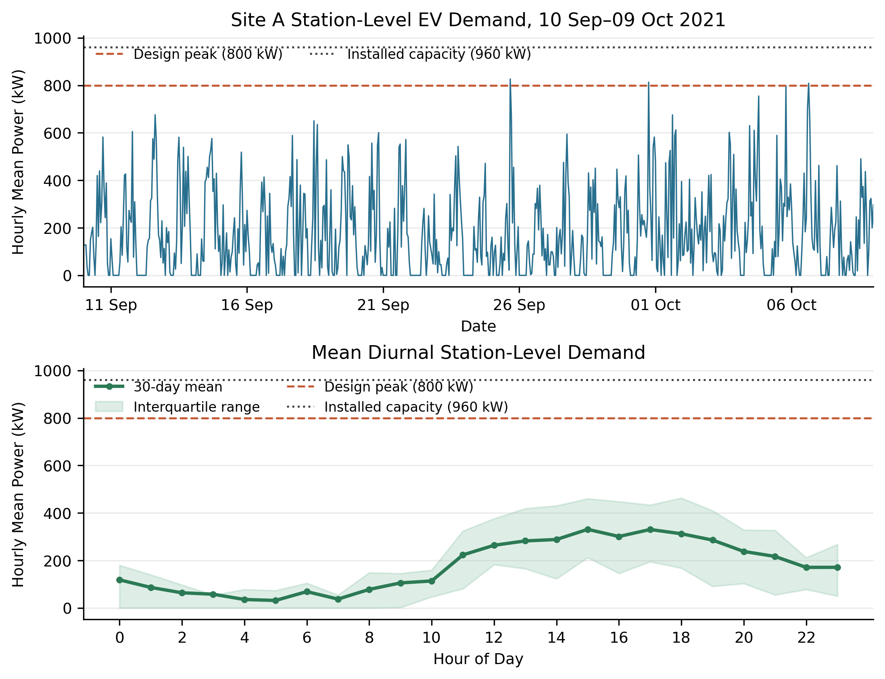
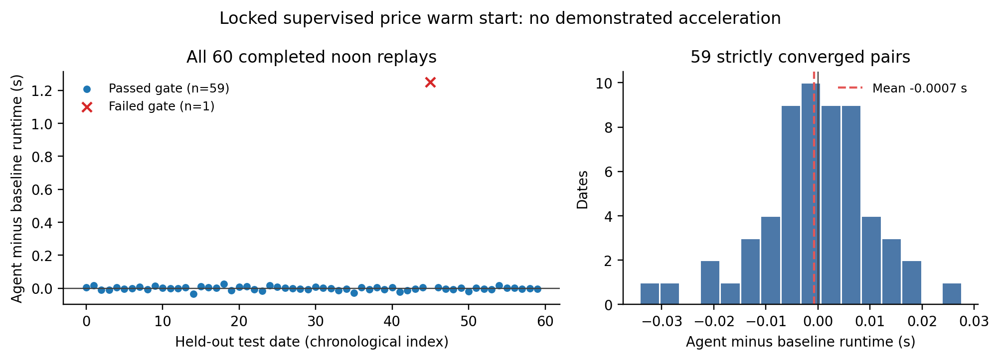
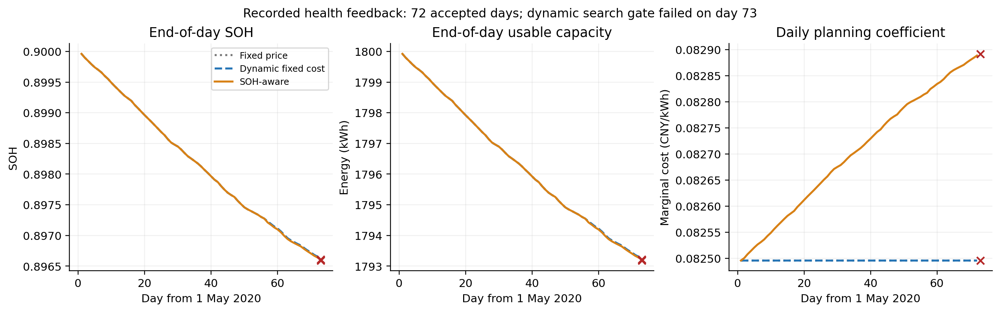
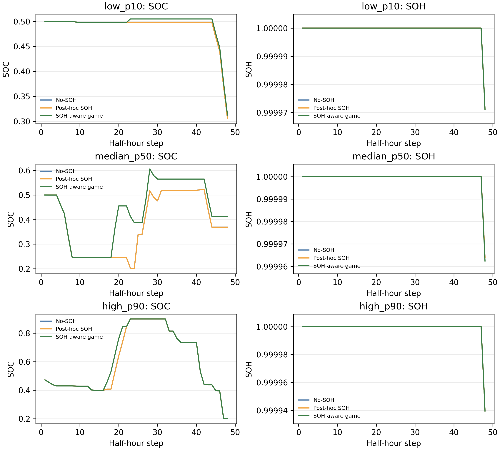
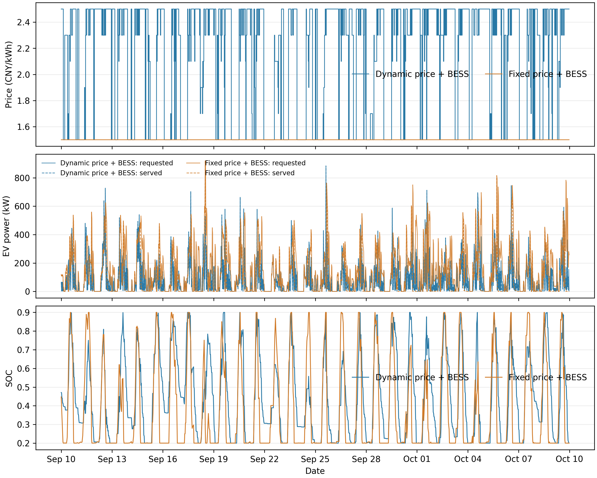
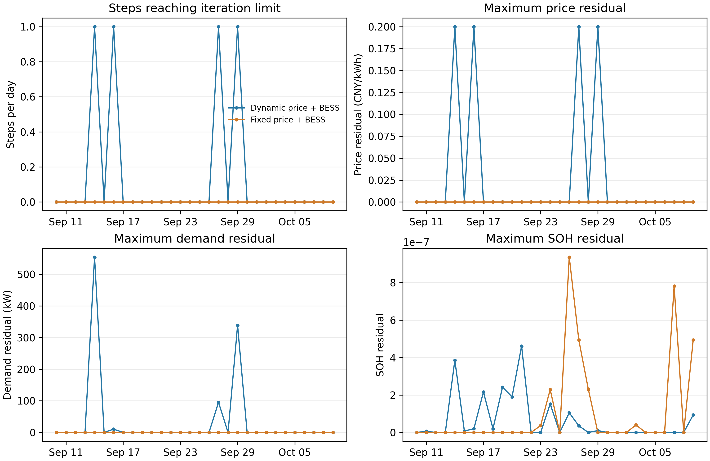
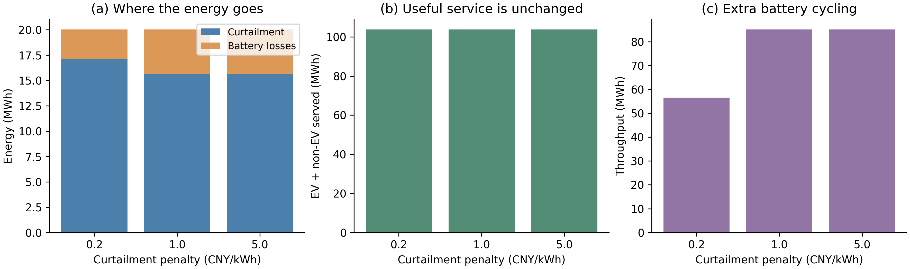
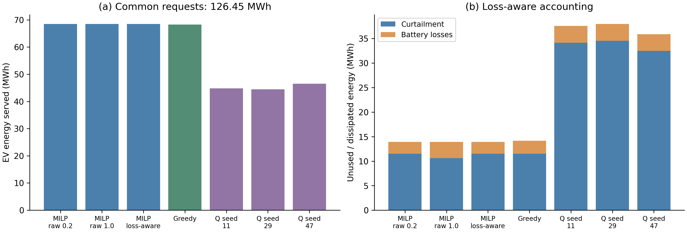

# Integrating Battery State of Health into Rolling Leader-Follower Pricing and Dispatch for an Islanded Highway EV Charging Microgrid: A Feasibility Study

## Abstract

This study proposes a method for incorporating battery state of health (SOH) into rolling leader-follower pricing and storage dispatch at an islanded highway electric vehicle (EV) charging station. SOH changes the operator's usable-capacity constraint and marginal degradation cost, while executed trajectories update physical health at daily boundaries. Feasibility is assessed through mechanism ablations, energy and delivered-revenue identities, and continuous state-transfer checks, rather than assumed economic superiority. The frozen system comprises 400-kW PV, 100-kW wind, a 2000-kWh/800-kW BESS, and eight 60-kW charging posts, with date-matched ERA5 physical drivers. Of 144 independent-day ablation cases, 136 passed all declared gates and eight failed the cumulative energy gate. A planned 90-day common-request diagnostic produced 72 accepted consecutive days in both dynamic arms; each passed 3456 half-hour energy and SOC checks. In the SOH-aware arm, health declined from 0.900000 to 0.896641 and the marginal coefficient increased from 0.082496 to 0.082888 CNY/kWh, demonstrating active cross-day feedback. Both dynamic arms failed the coordinate-search stopping test on day 73, so full-window solver reliability is not established. Because the continuous diagnostic fixes requests, it validates health-dependent dispatch and accounting, not strategic price responsiveness or equilibrium. Its conditional modeled-value gain does not establish general profitability or lifetime improvement. The evidence supports a computationally implementable SOH-coupling method over the accepted tested domain, with explicit limits on convergence and deployment.

**Keywords:** electric vehicle charging; battery state of health; dynamic pricing; islanded microgrid; delivered-energy revenue; weather-driven renewable generation

## 1. Introduction

Highway EV charging couples concentrated arrivals and limited dwell times with substantial electrical demand. For an islanded station, renewable generation and battery energy storage must meet that demand without grid imports. A charging operator therefore faces two connected decisions: how much energy to make available at each time, and what tariff to offer users. Prices can change modeled charging requests and revenue, while battery decisions shift renewable energy between periods. The resulting balance depends on both demand assumptions and the accounting boundary used to measure renewable utilization.

Battery health adds a slower state to this problem. Charging and discharging cause aging; aging reduces usable energy capacity and changes the economic consequences of later dispatch. Calculating a lifetime cost only after scheduling cannot transmit this state dependence back to the operational decision. Conversely, a detailed electrochemical aging model may be unsuitable for repeated tariff searches. An operationally convenient approach uses a tractable marginal degradation proxy during scheduling and a trajectory-based health transition at a slower boundary.

Leader-follower EV pricing [1] and islanded microgrid coordination [2] provide foundations for this approach. However, an implemented controller must be assessed beyond aggregate revenue. A higher service fraction can arise because a tariff suppresses requests. Lower curtailment can arise because storage dissipates more energy. A completed simulation can contain decisions that have not reached the stated fixed-point tolerance. These distinctions matter when interpreting the additional role of SOH.

The central question is whether SOH can enter the operator's decision problem before dispatch, with its consequences carried consistently into the next decision. The method connects two time scales: operational price-response and storage decisions use a health-dependent feasible set and degradation coefficient; daily executed SOC and throughput update the physical battery state. SOH is a state of the operator's asset, not an additional player. The follower retains its own charging-allocation objective. Health can therefore affect the operator's candidate-price evaluations indirectly through storage feasibility and cost, without requiring the user to optimize battery health.

The contributions are: (i) an explicit capacity-and-cost interface that incorporates SOH into the rolling leader-follower decision model; (ii) a state-transfer and accounting protocol that connects executed dispatch to subsequent health-dependent decisions; and (iii) bounded feasibility evidence from component ablations and continuous ledgers, including failed cases. The study tests implementation and numerical executability under declared assumptions. It does not require the health-aware policy to outperform every baseline. Learning assistance is an auxiliary diagnostic and is not the proposed method's defining contribution.

The scope is a feasibility study. It does not establish a globally optimal Stackelberg equilibrium, a causally identified tariff response, or a battery lifetime prediction. The station model is aggregate, and network quantities are evaluated after scheduling. Sections 2-5 describe the literature, data, model, and solution procedure. Sections 6-7 present the experimental design and results; Sections 8-9 discuss implications and conclusions.

## 2. Related Work

### 2.1. Charging prices and microgrid coordination

Cheng et al. formulate personalized, network-aware charging prices using a sequential Stackelberg game [1]. Their work motivates the operator-user interaction considered here. Singh et al. study DC microgrid operation with hybrid energy storage, islanding constraints, and demand-response coordination through a bi-level Stackelberg approach [2]. These studies establish relevant pricing and coordination settings; they do not validate the behavioral coefficients or network approximations in the present implementation. The present problem concerns one islanded station, six tariff levels, aggregate charging allocation, and a daily health transition.

Operational scheduling under uncertain EV demand is also relevant in adjacent infrastructure, including battery swapping [12]. This distinction underscores a limitation of deterministic historical replay: access to an observed demand profile does not remove uncertainty in future arrivals or identify counterfactual demand under a different tariff. Here, the transaction dataset [3] supplies observed baseline activity, while counterfactual price response remains an assumed scenario relation.

### 2.2. Battery degradation in operational decisions

Stationary battery design and operation depend jointly on application requirements, storage components, and aging considerations, as reviewed by Hesse et al. [4]. Mechanism-oriented aging work [5], cell-specific holistic models [6], life-assessment models [7], cycle-aging costs in electricity markets [8], and calendar-aging studies [9] address different levels of this problem. These strands motivate separating a computational proxy used inside scheduling from a trajectory evaluation used for accounting.

The implemented model follows this separation but remains substantially simpler than a calibrated cell model. It uses throughput and the daily SOC range for cycling, a piecewise average-SOC calendar term, and a linear residual-value rule. These equations are implementation assumptions. Their coefficients are not transferred from the cited papers as experimentally validated values for the study battery. No rainflow cycle decomposition, temperature dynamics, chemistry-specific identification, or measured end-of-life validation is included.

### 2.3. Rolling control and learning

Receding-horizon optimization executes a first action and resolves as the state changes. The stability and optimality theory for constrained model predictive control [10] illustrates why a rolling implementation alone is insufficient to establish those properties. The present controller includes discrete tariff searches and an outer demand-health update. Its convergence must be checked empirically, and no closed-loop stability theorem is claimed.

Q-learning [11] offers an alternative for learning a policy from repeated interaction. Whether it helps depends on state representation, actions, reward, training distribution, and execution constraints. A tabular controller is used here only as an exploratory diagnostic after testing the existing optimizer. It is not a comprehensive comparison of reinforcement learning with mathematical optimization, nor a learned pricing equilibrium.

## 3. System and Data

### 3.1. System boundary and parameters

The microgrid comprises photovoltaic (PV) and wind generation, a battery energy storage system (BESS), eight charging posts, and an assumed non-EV load. There is no external energy import. The network calculation has a reference-voltage node at the storage bus; this reference does not create an energy source. Deficits remain unserved demand and surplus generation is curtailed.

Table 1 fixes the second-round main configuration from the model freeze: 400-kW PV, 100-kW wind, 800-kW/2000-kWh BESS and eight 60-kW charging posts. Aggregate EV service is limited to 480 kW. Earlier historical figures used a different 800-kW/1200-kWh BESS and eight 120-kW posts; those trajectories remain in Section 7 as separate first-draft diagnostics and are not pooled with the second-round main case.

**Table 1. Main parameters and their interpretation.**

| Quantity | Value | Interpretation |
|---|---|---|
| PV / wind rating | 400 / 100 kW | Assumed available-power profiles |
| BESS power / nominal energy | 800 kW / 2000 kWh | Model-freeze main configuration |
| Charging equipment | 8 posts, 60 kW each | 480-kW aggregate equipment limit |
| Station design peak | 420 kW | Reference concurrent EV design quantity; assumed p90 simultaneity |
| Non-EV demand | 60 kW | Constant assumption |
| Initial SOC / SOH | 0.50 / 1.00 | Unless a stress test is specified |
| Planning SOC bounds | 0.10-0.90 | Terminal SOC at least 0.20 |
| Execution SOC reserve | 0.20 | Stricter than planning minimum |
| Charge / discharge efficiency | 0.95 / 0.95 | Constant conversion efficiencies |
| Tariff grid | 1.5 to 2.5 CNY/kWh, step 0.2 | Fixed-price reference: 1.5 |
| Elasticity / reference tariff | 1.157 / 1.4 CNY/kWh | Scenario response parameters |
| Dispatch step / forecast slots | 0.5 h / 24 slots | First slot 0.5 h; others 1 h |

### 3.2. Historical EV baseline

The source is version 3 of the public Figshare dataset, A High-resolution Electric Vehicle Charging Transaction Dataset with Multidimensional Features in China [3]. Site A is selected as the main station. Cleaned session energy is distributed across hourly bins according to session duration, and normal-session energy forms the baseline. Following the author's station-data interpretation, the historical series is treated as single-post demand and multiplied by eight to obtain total station demand. This mapping is an author-specified interpretation; it has not been independently established by the dataset publisher. Post identifiers alone are not used to infer the physical charger count.

The baseline is observed activity under prevailing operating conditions. It is neither unconstrained latent demand nor an empirical response curve for six unobserved tariffs. The second-round 60-kW per-post rating is an equipment limit, not an expectation that every post draws 60 kW continuously. The earlier 120-kW rating belongs to the historical first-draft configuration. Historical hourly averages can remain low when utilization is low.

Low-, median-, and high-demand dates are chosen nearest the P10, P50, and P90 quantiles of normal daily energy. They are 2 January 2020, 3 July 2020, and 17 September 2021, with station-mapped baseline energy 582.24, 1545.04, and 3679.36 kWh/day. A contiguous 30-day high-energy window, 10 September-9 October 2021, is used separately for pricing. This is a selected demanding period, not a random sample representing every season. Figure 1 shows observed demand before counterfactual tariff response.

**Figure 1.** Observed Site A station demand in the selected 30-day window, after the author-specified eight-post aggregation. Equipment and design ratings are reference lines. Baseline demand differs from the controller's endogenous requests.

### 3.3. Historical renewable and forecast assumptions

The first-draft PV and wind inputs follow repeated typical daily profiles scaled to the stated ratings. PV peaks at 400 kW; wind remains below its 100-kW nameplate. Those inputs are assumed available generation, not date-matched measured output or validated forecasts for the transaction dates. Historical daily renewable energy is 4187 kWh and assumed non-EV demand is 1440 kWh. No forecast-error distribution was sampled in those experiments.

The provider cycles each date's own 24-hour EV profile to fill its look-ahead window. Actual SOC and SOH can therefore propagate across dates while the forecast repeats the current date, rather than using the next observed date. This deterministic approximation can affect end-of-day decisions. Original A/B/C forecast files are retained but are not used here because their dates and EV power scale do not match this historical station setup.

### 3.4. Date-matched weather-to-power conversion for the second-round experiment

The second-round replay joins each Site A demand date to hourly ERA5 reanalysis by local time (China Standard Time = UTC+8). The weather grid is a 0.25-degree ERA5 point and is a spatial proxy for the station, not on-site instrumentation. Raw GRIB metadata confirms `ssrd` is a one-hour solar-radiation accumulation whose validity timestamp marks the **end** of that hour. For dispatch during 10:00-11:00 local time, the runner therefore uses the `ssrd` record valid at 11:00; the two half-hour actions share that hour's mean irradiance `G = ssrd/3600` W/m2. Available PV power is modeled as `400 clip(G/1000,0,1)` kW without temperature derating. Hourly wind speed is derived from the 100-m vector `v = sqrt(u100^2+v100^2)` m/s; the mean of the start- and end-hour speed samples approximates dispatch-hour speed. A declared piecewise turbine curve returns zero below 3 m/s, a cubic ramp from 3 to 12 m/s, 100 kW from 12 to 25 m/s, and zero above 25 m/s. These thresholds and the wind interpolation are engineering assumptions. Both series are capped at the frozen 400/100-kW nameplates. No irradiance transposition, panel tilt, wake, downtime, or site-specific turbine calibration is available. Reanalysis is used as a date-matched physical driver, not a validated forecast; forecast claims require a separate held-out forecasting test. Each experiment records the grid point, timezone conversion, missing-hour handling, weather file checksum, and exact formulas.

## 4. Rolling Pricing and Health Model

### 4.1. State and time representation

The operational state contains SOC, daily SOH, aggregate outstanding energy, previous executed price, and forecast information. At each half-hour step the operator selects a horizon price vector and storage schedule. Only the first action is executed. The forecast has 24 slots, but the first lasts 0.5 h and the remaining 23 last 1 h; its effective duration is 23.5 h. Equations use slot-specific duration to preserve this distinction.

Aggregate groups represent current flexible demand, future hourly demand, and any backlog. Future groups allocate across adjacent slots, including the current slot for the next-hour group. Individual arrivals, post assignments, vehicle SOC, and departure guarantees are not tracked. In the main configuration the current flexible fraction is one and initial backlog is zero; the implemented backlog update then keeps it at zero. This is not a validated vehicle queue.

### 4.2. Forecast and follower response

At outer iteration k, a scalar forecast price is initialized from the previous executed price. Baseline EV power is scaled using a constant-elasticity scenario relation:

\[
\widehat P_t^{(k)}=\widehat P_t^{base}(\bar p^{(k)}/p_{ref})^{-\epsilon}. \qquad (1)
\]

The tariff returned by the inner solve updates the forecast price toward the mean horizon price. The follower also adjusts each group's energy cap relative to the price used to construct that forecast. For group i, with available slots A_i and mean offered price p_i, its effective cap is

\[
\widetilde E_i=E_i^{max}(p_i/\bar p^{(k)})^{-\epsilon}. \qquad (2)
\]

For a fixed price vector, the follower solves the linear allocation problem

\[
\max_e\;\sum_i\sum_t(v_i-p_t)e_{i,t}. \qquad (3)
\]

Energy is nonnegative, zero outside the availability window, and bounded by group power times slot duration. Total group energy is at most the effective cap and at least the smaller of that cap and the specified minimum. A shared station constraint applies:

\[
\sum_i e_{i,t}\leq (480-P_{EV,t}^{rigid})_+\Delta t_t. \qquad (4)
\]

The positive part denotes the maximum of its argument and zero. Group values in these runs are all raised to 2.51 CNY/kWh, above the highest tariff. Willingness-to-pay threshold crossings therefore do not produce the observed response. Response arises mainly through energy-cap relations, allocation windows, and the congestion penalty. The coefficient 1.157 is a scenario proxy, not a causally identified station elasticity.

A further detail affects the second half of each hour. Its current request is the positive remainder of scaled hourly energy after subtracting observed baseline power multiplied by elapsed time, divided by 0.5 h. The subtracted observation is the original baseline rather than previously executed counterfactual service. This aggregation rule can introduce half-hour discontinuities and is a limitation of the demand interface.

### 4.3. Storage and operator objective

Let h denote SOH and E_nom nominal energy capacity. The SOH-aware planner uses effective capacity E_nom times health. The independent-day capacity ablation can instead plan at nominal capacity while retaining health-dependent execution. In the continuous matched-cost diagnostic, all arms use current health-dependent capacity in planning and execution; its dynamic-arm contrast isolates refreshed versus frozen marginal cost, followed by the resulting state-path effects. Charge and discharge are nonnegative, mutually exclusive through a binary mode variable, and each is bounded by 800 kW. Their SOC transition is

\[
s_{t+1}=s_t+\frac{(\eta_cP_t^{ch}-P_t^{dis}/\eta_d)\Delta t_t}{E_{nom}h}. \qquad (5)
\]

In the historical controller and independent-day diagnostics, planning allows SOC 0.10-0.90 and terminal SOC at least 0.20, whereas execution enforces a 0.20 reserve at every step; execution may reduce a planned discharge. The continuous precision runner explicitly uses 0.20-0.90 in both planning and execution, with terminal minimum 0.20. These protocol differences are recorded rather than pooled.

For requested EV power q_t, non-EV demand b_t, renewable power r_t, planned curtailment c_t, and separate EV and non-EV shed power u_t^{EV} and u_t^{N}, the corrected leader planner uses

\[
r_t+P_t^{dis}+u_t^{EV}+u_t^{N}=b_t+q_t+P_t^{ch}+c_t. \qquad (6)
\]

For each candidate tariff, the follower LP determines requests and a mixed-integer linear program (MILP) optimizes storage and shedding. The tariff search evaluates

\[
J=\sum_t p_t(q_t-u_t^{EV})\Delta t_t-C_{deg}^{proxy}-C_{shed}-C_{curt}-C_{cong}. \qquad (7)
\]

The degradation proxy is marginal cost times charge-plus-discharge throughput. The second-round leader uses 100 CNY/kWh for EV shedding and 1000 CNY/kWh for non-EV shedding in the current main case, both explicitly assumed. Curtailment retains 0.2 CNY/kWh. In second-round comparisons, congestion terms must normalize by the declared 480-kW equipment limit. The historical 960-kW normalization remains a first-draft diagnostic. This cost is a planning proxy, not a measured waiting-time cost. The price-ramp penalty is zero.

Equation (7) now credits only EV energy retained after planned EV shedding. The first-draft experiments used requested-energy candidate revenue and aggregate shedding, so their planned profit cannot be reinterpreted as the corrected objective. Physical execution can still differ from the plan because of network losses and the stricter SOC reserve; reported ex-post revenue always uses actual delivered EV energy.

### 4.4. Daily health and aging cost

SOH is the physical slow state within a day. A provisional one-step health estimate enters the outer iteration; physical health is updated once at the daily boundary from the executed trajectory. Cycling uses daily throughput Q and SOC range D:

\[
Q_d=\sum_{t\in d}|P_t^{BESS}|\Delta t_t,\quad D_d=\mathrm{clip}(s_{max}-s_{min},0.01,1). \qquad (8)
\]

\[
\Delta h_d=\frac{k_{cal}(\bar s_d)}{365}\frac{H_d}{24}+\gamma Q_dD_d^{\alpha-1}. \qquad (9)
\]

Gamma is 1.5e-8 per kWh, alpha is 1.5, and H_d is observed hours. Annual calendar coefficients are 0.01, 0.015, 0.025, and 0.04 for average-SOC bands 0.10-0.50, above 0.50-0.80, above 0.80-0.90, and above 0.90-1.00. The health-group transition applies this loss within its implemented group representation; it is not a cell-level electrochemical calculation.

The current continuous protocol uses a declared nominal replacement-value reference C_ref = 2,000,000 CNY (2000 kWh times 1000 CNY/kWh) for both trajectory aging valuation and the planning marginal coefficient, with a residual-value derivative of 1/0.30. C_ref is not reduced again with usable capacity. The coefficient is refreshed from the incoming physical health at each daily boundary; historical outer-loop variants also evaluate provisional health. For the single-group battery, reference DOD 0.5 and the interim low-health wear multiplier give:

\[
c_{deg}(h)=\frac{C_{ref}\gamma(0.5)^{\alpha-1}}{0.30}\left[1+0.5\left(1-\frac{h-0.70}{0.30}\right)\right]. \qquad (10)
\]

Health is clipped to 0.70-1.00 for this coefficient. The historical SOH-independent planner used 0.05 CNY/kWh, so those early ablations mix coefficient choice and health feedback. The corrected continuous fixed-cost baseline instead freezes the SOH-aware initial coefficient, 0.082495791 CNY/kWh at SOH 0.90. Daily trajectory aging is valued consistently and deducted once for every arm; it remains a model-based evaluation, not measured physical aging.

### 4.5. Second-round objective and service accounting

For each interval of duration `dt_t` hours, EV revenue is `price_t * EV_served_t * dt_t` CNY. The dispatch objective uses physically delivered EV energy where the model can separate curtailment and shedding; a requested-energy revenue term must not be interpreted as realized profit. EV unmet energy is `EV_requested_t - EV_served_t` after the EV equipment limit and execution layer. Non-EV unmet energy is recorded separately. The net operating value reported in the comparison is delivered-energy revenue minus modeled battery aging, EV and non-EV shortfall penalties, and stated operating costs; the narrower revenue-minus-aging measure is additionally reported to remain comparable with historical records. All kW-to-kWh conversions use the interval duration explicitly. Renewable curtailment, battery conversion loss, network loss, and terminal stored-energy change are shown together in an energy identity.

The second-round primary configuration follows the model freeze: 400-kW PV, 100-kW wind, 800-kW/2000-kWh BESS and eight 60-kW charging posts (480 kW). The first draft used 800-kW/1200-kWh BESS and a 960-kW EV cap; those results are historical diagnostics under another configuration. The second-round runner records the exact configuration and never merges outputs across ratings. The 960-kW short-window case is an explicitly labeled charging-cap sensitivity, with the same 2000-kWh BESS, and is not part of the primary comparison. The corrected leader optimization uses a stated non-EV shortfall penalty of max(1000, ten times the EV shortfall penalty) CNY/kWh to preserve non-EV service priority when supply is scarce; this is a modeling preference, not an observed welfare valuation, and is held fixed across arms.

### 4.6. How SOH enters the leader-follower decision

The coupling has three explicit links. First, incoming health sets usable battery energy in the leader's SOC transition and feasible set, Equation (5). Second, health sets the marginal throughput cost subtracted when comparing candidate prices, Equations (7) and (10). Third, the executed trajectory updates health through Equations (8)-(9), and the next daily solve receives that updated state. A post-hoc aging charge alone implements only accounting; it does not implement the first two links. A stored SOH field alone is likewise insufficient evidence unless the capacity or cost used by the solver changes with it.

This is a rolling health-parameterized leader-follower method. Neither a nonzero SOH update nor a changed dispatch proves that the optimal price must change: constraints, rigid demand, discrete prices, and the execution adapter can leave the selected tariff or delivered service unchanged. Component ablations test whether the interface is active; continuous replay tests whether state and accounting remain connected. A responsive-user equilibrium claim requires additional evidence beyond a fixed-request replay.

## 5. Solution and Execution

### 5.1. Bounded price-demand iteration

The inner procedure performs coordinate ascent on the discrete tariff vector. Each candidate calls the follower LP and storage MILP. Main experiments allow one coordinate sweep per outer iteration. The outer procedure updates forecast price, requests, and provisional health, stopping when maximum changes in price, response power, and SOH are at most 0.001, or after 20 iterations. These residuals have different units; their numerical maximum is an implementation criterion, not a dimensionless equilibrium certificate. The separate forecast-price fixed-point residual is recorded but is not included in that stopping test.

A single coordinate sweep does not certify that a tariff vector has no profitable deviation. Follower allocation can be nonunique. Accordingly, a converged step means only that the implemented outer test was met. A nonconverged step stays flagged and its action remains in the trajectory. Removing those rows cannot repair their effects on subsequent states.

Additional diagnostics apply adaptive damping to forecast-price updates and allow up to 40 iterations at saved problematic states. Damping is reduced after a residual sign change or growth and increased after substantial contraction. These are independent state replays, not replacements for a continuous simulation. The implementation uses Pyomo and HiGHS through appsi. The continuous common-request runner is a distinct diagnostic: it uses shrinking half-hour perfect-trace horizons within each day and at most two coordinate sweeps. Its recorded acceptance test is an absolute difference of at most 1e-6 CNY between the final two sweep objective values. This objective-stagnation flag is not the historical outer price-demand-SOH residual test, nor proof that every unilateral deviation has been exhausted.

### 5.2. Algorithm 1: rolling SOH coupling and execution

**Inputs:** dated EV/weather traces or a declared forecast; frozen equipment, tariff grid and penalties; initial SOC and full battery-group state; solver limits and acceptance gates. **Outputs:** price, requests, separately delivered EV/non-EV energy, battery actions, carried health/SOC, cost ledger and failure flags.

1. At the daily boundary, receive the complete physical battery state and SOC from the preceding executed day. Set usable capacity from health. Compute the health-dependent marginal coefficient; in the matched fixed-cost ablation, retain the same initial coefficient instead.

2. At each half-hour decision, assemble the declared horizon and user availability. For each candidate tariff considered by the bounded coordinate search, solve the follower allocation and the leader storage/service MILP using that capacity and coefficient. The responsive-user formulation uses Equations (1)-(4); the common-request diagnostic fixes user energy and availability to isolate the health/dispatch interface.

3. Record the stopping test actually used and every exhausted iteration limit. The historical outer controller uses its component residuals; the continuous diagnostic uses final-sweep objective stagnation. Do not label either as a global equilibrium certificate. If assistance is enabled, a locked Agent supplies only a legal starting price vector to the same search.

4. Execute only the first half-hour action through the physical adapter. Record requested and delivered EV energy, non-EV shortage, conversion and network losses, curtailment, and SOC. Compute realized EV revenue as price times delivered kWh. Preserve the distinction between planned and executed actions.

5. At day end, calculate aging from executed SOC and throughput, update the full battery state, and record stored-energy revaluation when health reduces capacity. Apply declared replacement rules and keep replacement expenditure separate from operating value. Pass the updated state and SOC to the next date without resetting health.

6. Apply the unchanged energy, SOC and solver gates. Retain a failed day's records and status; an accepted prefix is not a completed full-window validation. Any numerical or search repair must be reported as a separate replay or a newly versioned continuous run.

The proposed method requires no learning agent. The supervised warm-start and historical storage-only Q-learning tests in Section 7 are auxiliary negative diagnostics, not evidence that reinforcement learning establishes SOH feasibility. Their training, validation and test boundaries remain separately reported.

### 5.3. DC network post-check

The first storage command is clipped to physical limits. A resistive DC calculation evaluates voltage, current, and network loss using a storage reference node, a 0.4-kV base, and three 0.005-ohm branches to PV, wind, and load buses. These are prototype assumptions rather than surveyed infrastructure. Voltage bands 0.95-1.05 per unit are assessed after dispatch.

For a deficit, execution first increases feasible discharge, then reduces flexible EV service; remaining rigid deficits are recorded. For surplus, it curtails PV, then wind, before adjusting excess battery charging. Execution does not independently optimize storage for every surplus. Voltage and branch-current constraints are not embedded in tariff optimization, and thermal ratings are unavailable. This layer supports accounting and diagnostics, not a claim of network-security compliance.

## 6. Experimental Design and Accounting

### 6.1. Ablation and price comparison

No-SOH excludes SOH from planning. Post-hoc SOH uses identical dispatch but deducts aging afterward. SOH-aware includes health-dependent capacity and marginal cost. All variants share physical aging. For fair comparison, revenue minus trajectory aging is calculated for all three; No-SOH gross revenue is not compared directly with net values.

Each representative date starts independently at SOC=0.50, SOH=1, zero backlog, and price 1.5 CNY/kWh. A high-demand stress test starts at SOH=0.80. The 30-day dynamic/fixed comparison begins from matched states and carries SOC, SOH, previous price, and implemented backlog within each arm. Fixed pricing offers 1.5 CNY/kWh. Neither experiment is a randomized empirical tariff test.

Metrics include requested, served, and unserved energy; service fraction; curtailment; throughput; aging cost; price counts; state endpoints; residuals; and runtime. Revenue minus aging excludes capital recovery, other operating costs, and unserved-demand welfare. Different endogenous request totals are always reported alongside service fractions.

### 6.2. Common-request energy audit

The first control fixes the original dynamic arm's requests and each source day's incoming SOC/SOH. Independent 48-slot daily schedules are solved at raw curtailment penalties 0.2, 1, and 5 CNY/kWh, with planning SOC minimum 0.10 and terminal minimum 0.20, without network execution. These 90 schedules are daily replays, not a new continuous trajectory. Because this optimizer sheds aggregate demand, its primary service metric is total EV plus non-EV energy supplied. A non-EV-first split is used only for additional accounting; it is not a separate optimizer priority constraint.

Battery conversion loss at the common power boundary is

\[
L_{bat}=\sum_t\left[(1-\eta_c)P_t^{ch}+(1/\eta_d-1)P_t^{dis}\right]\Delta t_t. \qquad (11)
\]

Renewable energy equals served EV plus served non-EV energy, curtailment, battery losses, and stored-energy change. Network loss is an additional term for network execution. At matched service and stored energy, replacing curtailment with battery losses does not improve useful delivery.

### 6.3. Loss-aware objective and conditional Agent test

A second benchmark fixes observed station-mapped requests for all 30 dates, resets SOH to one daily, bounds SOC at 0.20-0.90, and fixes initial and terminal SOC at 0.50. Unlike the original controller, it separates EV and non-EV shedding with weights 100 and 1000 CNY/kWh. Four perfect-information daily MILPs compare raw penalties 0.2, 1, and 5 with weight 1 applied to curtailment plus Equation (11). Marginal throughput cost is common.

Only if increasing raw penalty from 0.2 to 1 fails to improve EV service or reduce curtailment-plus-losses by more than 1 kWh over the window does the protocol proceed to Agent training. This is an explicit practical threshold, not a statistical significance test. A curtailment-only reduction does not satisfy it.

The Agent controls only BESS power using tabular Q-learning. State features are half-hour, 15 SOC bins, seven current-request bins, and seven bins for next-six-hour net energy. Nine commands are -800, -400, -200, -100, 0, 100, 200, 400, and 800 kW. Reward is negative weighted EV shedding, non-EV shedding, throughput cost, curtailment, and losses, divided by 1000. Discount is one; learning rate is max(0.03, visits^-0.6); epsilon declines from 0.6 to a minimum of 0.03. Three seeds train for 6000 daily episodes each, sampled from 609 observed dates before 10 September 2021. Test dates never enter training.

Commands are projected to battery bounds and terminal reachability; this does not guarantee non-EV service. A continuous-command greedy rule uses the same projection. MILP has perfect daily information, the Agent has a compressed six-hour feature, and action sets differ. The loss-aware MILP minimizes the same surrogate stage cost used in the Agent reward and serves as an offline cost bound for this deterministic benchmark. The comparison can diagnose this Agent, but cannot rank all online learning and optimization approaches. There is no learned tariff or learned SOH game in this benchmark.

### 6.4. Four-arm paired test and uncertainty protocol

The second-round comparison has four prespecified arms: fixed tariff plus BESS; dynamic tariff with fixed marginal degradation cost; SOH-aware dynamic game; and Agent-assisted SOH-aware dynamic game. All arms replay the same physical EV requests, dated weather, half-hour step, initial SOC/SOH/backlog, equipment ratings, terminal-state rule and loss accounting. The fixed marginal cost is matched to the SOH-aware arm's initial coefficient for the chosen incoming SOH. Capacity feedback and cost feedback are additionally switched off one at a time, with the initial coefficient matched, to isolate the mechanism. Price-responsive requests are a separate scenario; they do not determine the primary common-request ranking.

A short window first checks energy identity (absolute residual at most 1e-6 kWh), revenue integration, EV/non-EV shortfall separation and convergence. The multi-day test then covers P10/P50/P90 demand and initial SOH 1.00, 0.90, 0.80 and 0.70 with at least three dates or independent seeds per cell. For each matched date and state, report the paired difference in net value, EV delivered energy, curtailment, curtailment plus battery and network losses, aging cost and wall-clock runtime. Report the number of converged/nonconverged/failed cases per cell; compute a 95% paired bootstrap interval across dates when enough independent dates are available, and otherwise give all individual differences without a confidence claim. Low-SOH, supply-constrained and renewable-surplus strata are declared from input state and weather-demand balance, before inspecting outcomes. Preserve negative and nonconverged results. A full four-arm claim requires a trained, locked Agent policy and a date-disjoint test set.

### 6.5. Operational definition of feasibility

Feasibility is assessed at three levels. **Model integration:** SOH must alter a declared solver capacity or objective coefficient, and daily executed actions must feed the next health state. **Numerical execution:** records must satisfy the declared energy/revenue identities, SOC bounds, state-transfer checks and the applicable stopping gate. Load shedding is allowed and reported; numerical feasibility does not mean all station demand is supplied. **Game solution:** a price-responsive follower and an adequately checked leader search are required before making a strategic-response or equilibrium claim. The first two levels are the present study's primary evidence; rigid common-request trajectories do not establish the third. Global convergence, thermal security, measured aging calibration and real-time deployment are outside the demonstrated claim.

## 7. Results

**Second-round evidence status.** Sections 7.0-7.0.4 report the corrected short-window check, auxiliary Agent test, continuous diagnostics and the feasibility evidence boundary. The tables and figures in Sections 7.1–7.5 are historical first-draft diagnostics; their values are retained for traceability and are not used to rank the revised four-arm policies. In particular, historical half-hour revenue needs explicit interval integration before any revised net-value result is released.

### 7.0. Corrected date-matched short-window check and experiment status

Raw ERA5 `ssrd` messages have a one-hour `stepRange` and use the hour-ending validity timestamp. The first date-matched runner erroneously selected the same-hour validity value for the following dispatch hour. Its previous 24-hour and three-date files are preserved for traceability but are superseded as weather-driven results. The aligned runner now uses the solar-radiation value valid at the end of the dispatch hour and approximates mean wind speed by averaging the two hourly boundary samples. Both half-hour actions within an hour share the hour's solar mean. The ERA5 grid point is a spatial proxy because the public station record does not establish a verified location coordinate.

The aligned four-slot check uses Site A on 4 May 2021, 10:00-12:00 China Standard Time, at initial SOC 0.50 and SOH 0.90. The fixed-price+BESS, dynamic-price+fixed-cost and SOH-aware dynamic-game arms share 124.4754 kWh physical EV requests and each delivers all 124.4754 kWh, with zero EV shedding and curtailment. Modeled renewable input is 78.5340 kWh; useful EV plus non-EV delivery is 244.4754 kWh; battery conversion loss is 8.7866 kWh, network loss 1.0049 kWh and stored-energy change -175.7329 kWh. The energy-identity residual is 8.53e-14 kWh. The dynamic fixed-cost and SOH-aware paths are identical because the initial marginal coefficient is matched and SOH changes only at the daily boundary. A fixed-tariff revenue of 186.7131 CNY versus 311.1885 CNY at the dynamic tariff reflects price arithmetic on the same rigid requests, not an identified pricing benefit. The locked Agent was evaluated separately in the one-hour noon test below.

The SOH-by-demand matrix was run from the aligned trace in separate checkpointed files. Its cases are independent daily resets, so they diagnose initial-SOH capacity effects but cannot by themselves establish a continuous multi-day lifetime benefit. Within-day degradation-cost feedback is dormant because SOH updates at the daily boundary. In one early SOH 0.90/P10 matched case, the capacity switch changed planned BESS power by up to 19.09 kW, yet the execution adapter rebalanced both plans to the same physical BESS action and service totals. The matrix therefore records planned and executed differences separately; a zero executed difference under this adapter is not proof that capacity feedback is intrinsically ineffective. Failed energy, convergence or data gates remain visible and are excluded from pass-only summaries. No confidence interval or policy ranking is assigned to the superseded three-date files.

The completed continuation covered all 144 planned independent-day cases: 136 passed every gate and eight failed the predeclared cumulative energy gate; no case had a BRI nonconvergence flag, and frozen source/input audits passed. The complete matched set contains 66 capacity-switch pairs and 68 cost-switch pairs. Cost-switch pairs had zero executed-action and aging-cost differences, as expected with daily SOH fixed. Twenty-eight capacity pairs had planning differences masked by execution. The largest observed planned BESS difference was 250.31 kW and the largest executed BESS difference was 246.27 kW, yet the maximum absolute EV-service difference across completed capacity pairs was below 1.2e-13 kWh. These purposively selected diagnostics support implementation checks but not a population interval, general policy ranking, continuous-life benefit, global Stackelberg optimum, or network-safety claim. Solver elapsed times include host pauses and are not independent CPU benchmarks.

### 7.0.1. Locked Agent warm-start test (auxiliary)

The chronological split contains 357 training dates in 2020 and 241 validation dates in January-August 2021; 61 September-October dates inspected during earlier diagnosis are excluded, and 60 November-December dates are reserved for testing. Neighbor count is selected only on validation data. One test date was previously inspected in a separately locked tiny-checkpoint smoke test without result-driven method changes, so this test is disjoint but not entirely untouched. The exact date manifest and checkpoint are retained.

A supervised k-nearest-neighbor retrieval Agent was trained from 714 noon price-slot labels on 357 training dates in 2020. The teacher's two-slot price vector was [1.5, 1.5] CNY/kWh on 353 dates and [1.5, 1.7] on four dates. Mean validation teacher-profit gaps over 241 dates were 0.00340 CNY for one neighbor and zero for three or five; a predeclared smaller-neighbor tie rule locked three neighbors before testing. The Agent proposes only a legal initial price vector to the unchanged SOH-aware bounded-response iteration (BRI) solver. This is supervised imitation, not reinforcement learning or an independent physical controller.

The held-out evaluation attempted all 60 November-December 2021 dates at initial SOH 0.80 and SOC 0.50. Each date executed two half-hour noon steps, with two forecast slots of 0.5 and 1.0 h; the result is a one-hour executed replay, not a full-day run. Fifty-nine paired dates satisfied both the solver and external forecast-price residual gate. On those 59, mean EV delivery was 25.8769 kWh, revenue 38.8154 CNY, battery throughput 117.2911 kWh, and aging cost 14.6370 CNY in both arms. EV shortage and curtailment were zero; all paired economic and physical differences were exactly zero at reported precision. On 16 December, both arms had a 0.05 CNY/kWh forecast-price residual against the predeclared 0.001 gate, despite an internal convergence flag. Its raw record is retained and excluded from pass-only performance means.

Across all 60 completed dates, mean solve-and-execute time was 2.7653 s for the unassisted solver and 2.7855 s for the Agent-assisted solver. The baseline-to-Agent ratio was 0.9928, with a 95% seven-date circular moving-block bootstrap interval of [0.9781, 1.0007] from 10,000 resamples. This shows no demonstrated acceleration. The interval reflects date variation conditional on one locked model; it does not measure training-seed or repeated-hardware timing uncertainty. The full pipeline took 1249.3 s, including 255.1 s for training-label generation. Near-constant teacher prices help explain why a learned warm start added little. This narrow test establishes a functioning fourth-arm interface, but provides no full-day or lifetime improvement claim.

**Figure 7.** Paired Agent-minus-baseline solve-and-execute time over the 60 held-out noon dates. The red cross marks 16 December, which failed the strict forecast-price convergence gate in both arms; the right panel shows only the 59 gate-passing pairs. The small date-to-date timing differences do not establish acceleration.

### 7.0.2. Continuous three-day state-transfer diagnostic

The aligned 1–3 May 2021 diagnostic used the same dated EV requests and ERA5-derived supply in the fixed-price+BESS, dynamic-price+fixed-degradation-cost, and SOH-aware dynamic-game arms. All began at SOC 0.50 and SOH 0.90 with the frozen main ratings. Unlike the independent-date matrix, each arm passed its complete battery-group state and SOC to the next day. Usable capacity declined in all arms as physical SOH declined from 0.9000000 to 0.8999313, 0.8998766, and 0.8998263 at successive day boundaries. The associated 0.2440 kWh total stored-energy capacity revaluation was recorded separately from battery conversion and network losses. The fixed-cost arm held its initial marginal aging coefficient at 0.0824958 CNY/kWh; the SOH-aware coefficient refreshed daily, reaching 0.0825039 CNY/kWh on day two. No replacement occurred.

Across the three days, all arms delivered 1156.9830 of 1177.1500 kWh requested EV energy, left 18.3637 kWh non-EV load unserved, incurred 1158.0542 CNY trajectory aging cost, and had 3907.8905 kWh curtailment plus battery and network losses. Dynamic fixed-cost and SOH-aware arms had identical physical trajectories and modeled operating value (-19380.77 CNY). Their difference from fixed price (-20525.69 CNY) was tariff revenue on the same fixed requests: 2880.39 versus 1735.47 CNY. This is a modeled value with shortage penalties, not measured station cash profit. Runtimes were 11.55 s for fixed price, 3136.20 s for dynamic fixed cost, and 3156.38 s for SOH-aware. The SOH-aware cost feedback changed its coefficient but did not change actions or improve service in this trajectory.

All nine original arm-day records failed the predeclared absolute daily energy-identity gate of 1e-6 kWh: residuals were 1.214e-6, 2.063e-6, and 1.472e-6 kWh on the three days, common across arms. No dynamic-arm BRI step was flagged nonconverged. An isolated higher-precision execution replay, using the original actions and daily input states without re-optimization, reduced the three residuals below 3.3e-10 kWh and left EV delivery, revenue, aging cost, SOC, and power actions unchanged; only approximately 1–2e-6 kWh per day of numerical curtailment changed. This localizes the gate failure to cumulative step-solver stopping error, but does not retroactively pass the original runs. The results are a mechanism and accounting diagnostic, not an accepted policy ranking or evidence of lifetime benefit.

### 7.0.3. Planned 90-day diagnostic: accepted prefix and failed stopping gate

The prespecified block is 1 May-29 July 2020, starting at SOC 0.50 and SOH 0.90 with the frozen main ratings. The 18 November 2026 audit found 90 accepted days in the fixed-price arm and 72 consecutive accepted days (1 May-11 July) in each dynamic arm. Both dynamic jobs recorded day 73, 12 July, as failed and stopped. At 02:00 local time, neither met its final-sweep objective-stagnation test within the two-sweep budget. Both day's energy identities still passed (absolute residuals 2.86e-11 and 2.88e-11 kWh). Thus the failure is the recorded search-stopping gate, not energy conservation; no full 90-day dynamic validation is claimed. Failed day 73 is retained and excluded from accepted-prefix totals. Days 74-90 were not executed in those runs.

For the 72 accepted paired dates, all three arms requested 8359.71 kWh and delivered 7406.38 kWh EV energy, with 953.33 kWh unserved. Dynamic fixed-cost and SOH-aware delivered-energy revenue was identical at 17631.69 CNY. SOH-aware minus dynamic fixed cost was -11.81 kWh non-EV unserved energy, -11.83 kWh curtailment plus battery/network losses, +94.04 CNY trajectory aging, and zero replacement expenditure. Modeled operating values were -13,653,476.31 and -13,665,199.25 CNY, respectively. The +11,722.94 CNY difference depends on the assumed 1000 CNY/kWh non-EV shortage valuation; both totals are strongly negative and are not project cash profits.

Revaluing the same paired physical outcomes gives -91.39 CNY at zero non-EV shortage penalty, -32.32 CNY at 5 CNY/kWh and +26.75 CNY at 10 CNY/kWh. The break-even penalty is 7.74 CNY/kWh. These are single-path sensitivity results, not population confidence intervals or an identified welfare benefit. The main feasibility claim does not rely on this conditional value advantage.

Recorded runtimes for the 72 matched dates were 441.58 s for fixed price, 160570.63 s for dynamic fixed cost, and 160701.28 s for SOH-aware. The dynamic-arm difference was +130.65 s. Host pauses and concurrent workload can affect these records; no controlled speedup or demonstrated half-hour deployment capability is inferred. These 72-day totals replace the earlier 69-day timing snapshot rather than being combined with it.

Each dynamic arm's accepted prefix contains 3456 half-hour records, SOC stays in 0.20-0.90, and terminal-SOC failures are zero. The maximum absolute daily energy residual is 2.33e-10 kWh. Prototype voltage reconstruction gives 0.99623-1.01219 pu, inside 0.95-1.05 pu, without a comparative voltage advantage. Every step's thermal verification remains unavailable because branch ampacity limits are unset. Accepted numerical execution does not imply uninterrupted demand satisfaction or surveyed-network security.

### 7.0.4. Evidence that the SOH interface is active

The ledger audit found no mismatch in any adjacent daily full-state or SOC handoff, no error in step revenue = executed price times delivered EV kWh, and no error in incoming usable capacity = 2000 times SOH. The audit is reproducible with `scripts/audit_soh_feasibility.py`; the source hashes and failed-day timestamps are retained in `soh_feasibility_audit_20261118.json`.

In the SOH-aware accepted 72-day path, SOH decreases from 0.900000000 to 0.896640771 and usable capacity from 1800.0000 to 1793.2815 kWh. Its recorded daily marginal coefficient rises from 0.082495791 to 0.082888297 CNY/kWh, whereas the matched dynamic baseline holds 0.082495791 CNY/kWh. The coefficient agrees with Equation (10) to 2.78e-17 CNY/kWh. These changes demonstrate that health affects the next solve's capacity and cost rather than merely being appended to an output table. The continuous contrast isolates cost refresh with common health-dependent capacity; the independent-day capacity-switch ablations separately demonstrate that capacity can alter planned actions.

**Figure 8.** Recorded daily SOH, usable capacity and marginal degradation coefficient in the continuous diagnostic. Curves show the 72 accepted days in each arm; the red crosses denote the retained failed day 73 in the dynamic arms. The fixed-price arm completed 90 days but is truncated here to the same displayed dates. Coefficient refresh is directly observable, while the later search-gate failure limits the reliability claim.

The responsive formulation in Equations (1)-(7) establishes where health enters the leader-follower model, and historical responsive runs show that the implementation can return tariffs and dispatch under that formulation. However, the continuous test uses fixed per-slot requests, so user energy cannot strategically respond to price. Its search-stagnation flag cannot prove a responsive game equilibrium. Existing evidence therefore supports model integration and bounded numerical executability. Robust price-responsive convergence, reliable completion of the entire 90-day dynamic block, and battery-lifetime or deployment benefits remain unestablished.

### 7.1. Representative-day SOH effects

All nine representative-day runs complete 48 steps and satisfy the implemented outer stopping test. This is an implementation diagnostic, not a general convergence or equilibrium certificate. No-SOH and Post-hoc share trajectories by construction. Table 2 gives daily comparisons and Figure 2 shows SOC and daily health transitions.

**Table 2. Independent representative-day ablations at initial SOH=1. Energy is in kWh; aging cost is in CNY.**

| Day | Planner | Requested | Served | End SOC | Aging cost |
|---|---|---:|---:|---:|---:|
| Low, P10 | No-SOH / Post-hoc | 515.23 | 515.23 | 0.3051 | 115.47 |
| Low, P10 | SOH-aware | 515.23 | 515.23 | 0.3123 | 115.68 |
| Median, P50 | No-SOH / Post-hoc | 1367.23 | 1340.97 | 0.3690 | 144.26 |
| Median, P50 | SOH-aware | 1367.23 | 1367.23 | 0.4127 | 150.34 |
| High, P90 | No-SOH / Post-hoc | 1802.08 | 1745.48 | 0.2000 | 242.02 |
| High, P90 | SOH-aware | 1802.08 | 1745.48 | 0.2000 | 242.02 |

On the median day, SOH-aware service increases by 26.26 kWh and modeled aging cost by 6.08 CNY. Revenue minus aging is 1900.51 CNY versus 1867.20 CNY for the common ablation trajectory. Throughput rises from 1019.81 to 1130.38 kWh. These are scenario-specific one-day differences, not evidence of a general health-aware advantage; the higher service is accompanied by higher modeled wear. Low- and high-demand service is unchanged. Low and median tariffs remain 1.5 CNY/kWh; high-demand variants use 1.5, 2.1, and 2.5.

**Figure 2.** SOC and day-end SOH on independent low-, median-, and high-demand dates. Overlapping No-SOH and Post-hoc curves reflect identical dispatch. SOH changes at the physical daily boundary.

The SOH=0.80 high-demand stress test completes, but SOH-aware reaches 20 iterations with maximum demand residual 662.21 kW. No-SOH and Post-hoc meet the stopping test and share their trajectory. The SOH-aware outcome is retained as a failure diagnostic and excluded from performance claims.

### 7.2. Thirty-day bounded-iteration price comparison

Each price arm completes 1440 half-hour decisions. Dynamic pricing has a higher modeled service fraction and revenue-minus-aging value, but lower absolute service and more curtailment (Table 3); its requested energy is also much lower. Because the arms do not serve a common endogenous request and the dynamic total includes four nonconverged steps, this is a descriptive bounded-iteration comparison, not evidence of policy superiority.

**Table 3. Thirty-day outcomes. Dynamic totals include four nonconverged outer steps.**

| Metric | Dynamic price + BESS | Fixed price + BESS |
|---|---:|---:|
| EV requested (MWh) | 61.7198 | 114.3664 |
| EV served (MWh) | 58.5683 | 67.1275 |
| EV unserved (MWh) | 3.1514 | 47.2389 |
| Served / requested (%) | 94.89 | 58.70 |
| Revenue minus aging (kCNY) | 126.5671 | 94.9018 |
| Renewable curtailment (MWh) | 20.1604 | 11.2697 |
| Battery throughput (MWh) | 51.4151 | 51.6671 |
| Mean tariff (CNY/kWh) | 2.1664 | 1.5000 |
| Outer-limit steps | 4 | 0 |

All six dynamic tiers occur: 2.5 CNY/kWh in 743 intervals (51.60%), 1.5 in 391 (27.15%), and intermediate levels in 306 (21.25%). The tariff varies, though boundary concentration remains substantial. This observed variation is an output of the finite discrete-price procedure; it does not validate the elasticity proxy or establish optimality. Figure 3 shows prices, endogenous EV power, and SOC.

Flagged decisions occur at 15:30 on 14 September, 18:30 on 16 September, 12:30 on 27 September, and 14:30 on 29 September. The largest demand residual is 554.50 kW and largest price residual 0.20 CNY/kWh. Fixed pricing has none. Both arms reach the 0.20 reserve. Figure 4 reports residual components separately.

Completed-day computation times sum to 13.00 h for dynamic pricing and 228.0 s for fixed pricing, excluding interrupted partial days and downtime. Fixed pricing avoids multi-tier search, so this is not a complexity-matched comparison. Recorded dynamic runtime is a practical limitation for direct half-hour online deployment.

**Figure 3.** Executed tariffs, EV requests and service, and SOC. The tariffs induce different requests; the dynamic arm includes four outer-limit steps.

**Figure 4.** Daily outer-loop audit. Residuals have different units. A completed daily file does not imply that every price-demand iteration converged.

### 7.3. Curtailment versus useful energy

An end-to-end one-day test on 10 September changes prices and requests. Increasing raw penalty from 0.2 to 5 reduces curtailment from 704.80 to 1.67 kWh, increases service from 2053.87 to 2760.86 kWh, and increases requests from 2053.87 to 2925.88 kWh. Service fraction falls from 100% to 94.36%. This shows that the penalty can change the price-demand trajectory; it does not isolate storage utilization or establish the economic validity of 5 CNY/kWh.

The common-request replay provides that control. All 90 daily MILPs report optimal termination, with maximum energy-identity residual approximately 1.2e-9 kWh. Table 4 and Figure 5 show why curtailment alone is misleading.

**Table 4. Daily replays using original dynamic requests and incoming states. Energy is in MWh.**

| Raw penalty (CNY/kWh) | EV + non-EV served | Curtailment | Battery loss | Curtailment + loss | Throughput |
|---|---:|---:|---:|---:|---:|
| 0.2 | 103.7477 | 17.1191 | 2.8932 | 20.0123 | 56.5029 |
| 1.0 | 103.7477 | 15.6535 | 4.3585 | 20.0120 | 85.0940 |
| 5.0 | 103.7477 | 15.6535 | 4.3585 | 20.0120 | 85.0948 |

From 0.2 to 1, curtailment falls by 1.4655 MWh but losses rise by 1.4653 MWh. Total useful service is unchanged; the approximately 0.264-kWh remaining change corresponds to stored-energy differences. Under the non-EV-first accounting split, EV service is 60.5547 MWh at both weights and non-EV shedding is 7 kWh; at weight 5 these become 60.5507 MWh and 3 kWh. Throughput rises about 50.6% and trajectory aging cost rises from 6431.56 to 7893.97 CNY. Thus the apparent 8.56% curtailment improvement is almost entirely transferred to dissipation, with no useful delivery gain.

**Figure 5.** Controlled replay separates curtailment from battery conversion losses. Total EV plus non-EV service is unchanged while extra cycling replaces curtailment with dissipation. Source incoming states are used; replay schedules are not a continuous execution trajectory.

Sequential charging and discharging across different intervals is sufficient to produce this behavior; simultaneous operation is unnecessary. A high curtailment penalty rewards consuming surplus, while throughput cost may be too small to offset that reward. For a complete ideal cycle at the assumed efficiencies, loss per unit throughput is approximately 0.05125. At SOH=1, the implemented marginal cost is approximately 0.04243 CNY per kWh of throughput, giving a raw-penalty break-even value of about 0.828 CNY/kWh. This calculation assumes unchanged useful service and terminal energy, with no additional binding constraint. A penalty of 1 can therefore reward dissipative cycling whereas 0.2 does not under these conditions. Weighting curtailment and conversion losses together removes that particular reward.

### 7.4. Loss-aware dispatch and Agent diagnostic

The second benchmark has common requests of 126.4518 MWh. All optimizer variants serve 68.4979 MWh. Raising raw penalty 0.2 to 1 reduces curtailment 11.5151 to 10.6120 MWh, but increases losses 2.3970 to 3.3000 MWh. Their sum stays 13.9121 MWh. The loss-aware objective restores 11.5151 MWh curtailment and 2.3970 MWh losses, with throughput 46.7719 MWh versus 64.3932 MWh for raw penalty 1. It avoids extra cycling without increasing delivery beyond the original low-penalty optimum.

The lack of useful-energy improvement triggers Agent training. Figure 6 and Table 5 retain every seed and the greedy reference. These are independent daily dispatch diagnostics, not a new pricing-health trajectory.

**Table 5. Held-out dispatch diagnostic. Requests are 126.4518 MWh; daily initial and terminal SOC are 0.50 for all methods.**

| Method | EV served (MWh) | Curtailment + loss (MWh) | Throughput (MWh) | Non-EV unserved (kWh) |
|---|---:|---:|---:|---:|
| MILP, raw 0.2 | 68.4979 | 13.9121 | 46.7719 | 0 |
| MILP, raw 1 | 68.4979 | 13.9121 | 64.3932 | 0 |
| MILP, loss-aware 1 | 68.4979 | 13.9121 | 46.7719 | 0 |
| Greedy with projection | 68.2451 | 14.1649 | 51.7054 | 0 |
| Q-learning, seed 11 | 44.8310 | 37.6010 | 67.0159 | 22 |
| Q-learning, seed 29 | 44.4388 | 37.9892 | 66.9578 | 18 |
| Q-learning, seed 47 | 46.5371 | 35.8859 | 65.9912 | 13 |

**Figure 6.** Common-request dispatch diagnostic. The Agent uses three seeds, compressed forecast features, and nine commands. MILP has perfect information. Battery endpoints match; information and actions differ.

Agent service is 44.44-46.54 MWh, below both MILP and greedy. It also leaves 13-22 kWh non-EV demand unserved. Independent replay saves 11,520 half-hour records across eight methods and 30 dates. Maximum state residual is approximately 2.6e-9 kWh, maximum power-balance residual below 1.2e-10 kW, and battery bounds and terminal equalities pass. These checks do not negate service failures. This Agent is unsuitable for replacing the optimizer; the result is not evidence against every learning approach.

### 7.5. Additional solver diagnostic

A three-day adaptive-damping run with raw penalty 5 covers 14-16 September 2021. Both arms complete 144 steps with continuous daily SOC/SOH endpoints. Dynamic pricing requests/serves 7.2864/6.5188 MWh; fixed pricing 10.4722/6.4489 MWh. Curtailment is 1.2522/1.4044 MWh. Dynamic pricing still has six outer-limit steps, maximum demand residual 5.609 kW; fixed pricing has none. These totals remain descriptive.

With up to 40 iterations, 3 of the six isolated incoming-state replays meet the current stopping test: 2021-09-14 13:30 (24 iterations); 2021-09-14 14:30 (22 iterations); 2021-09-16 01:30 (22 iterations). The remaining 3 reach the limit: 2021-09-14 22:30 (demand residual 1.46171 kW, price residual 0.2 CNY/kWh, forecast-price residual 0.005632 CNY/kWh); 2021-09-14 23:30 (demand residual 0.0118762 kW, price residual 0 CNY/kWh, forecast-price residual 0.001021 CNY/kWh); 2021-09-16 18:30 (demand residual 5.60904 kW, price residual 0.2 CNY/kWh, forecast-price residual 0.004449 CNY/kWh). Each replay matches its source demand residual at iteration 20. These results show that additional iterations help some states but do not resolve every flagged state. Meeting tolerance at an isolated state cannot certify a repaired multi-day path because a different earlier action changes later states. Full iteration traces and separate forecast-price residuals are retained. Original 30-day and three-day results are neither overwritten nor relabeled as converged.

## 8. Discussion and Limitations

### 8.1. Interpretation of SOH effects

Representative-day evidence demonstrates that daily health and marginal degradation can be propagated through this controller and can alter dispatch. It does not establish uniform health, service, or profit advantage. Median-day improvement accompanies more throughput and wear; two other days show no service change. Because the no-health planner uses a different fixed coefficient, this comparison combines coefficient choice with health feedback. A cleaner mechanism study would match the initial marginal coefficient and separately ablate capacity derating and cost feedback.

The continuous 72-day accepted prefix supplies direct state-transfer and coefficient-refresh evidence. Its day-73 search-gate failure limits numerical reliability, while its conditional value difference remains dominated by the non-EV shortage valuation and does not increase EV service. The low-SOH failure is relevant to the proposed mechanism: regimes where health constraints matter more can also challenge finite iteration. Reliable low-health operation and lifetime gains cannot be inferred from three SOH=1 examples or one 90-day seasonal block. No battery-lifetime replacement saving has been demonstrated. Before a continuous-life study, the day-73 stopping failure must be diagnosed and any repaired search validated on a separately versioned continuous path without relabeling the original failure. A subsequent study should complete the 90-day block, then run prespecified chronological seasonal blocks at matched initial SOH values (including 0.70, 0.80, 0.90 and 1.00), with at least three independent starting dates or weather years per condition. It should carry SOH, SOC, replacement state and costs continuously; predeclare replacement thresholds; retain every failed step; and report paired outcomes with uncertainty across independent blocks. Because the aging transition is an uncalibrated proxy, even a completed 365-day simulation would support modeled-life inference only, not a validated battery-life prediction.

### 8.2. Renewable use and EV priority

The original dynamic arm serves a higher fraction of a smaller endogenous request. Fixed pricing supplies more absolute EV energy and curtails less in that period. Neither observation alone ranks policies for common customers. An EV-priority claim requires common requirements, explicit departure obligations, and accounting for accepted as well as price-suppressed demand.

The energy audit demonstrates nearly one-for-one substitution of curtailment by conversion losses. A loss-aware objective removes this incentive without creating new service opportunity. At fixed requests and terminal energy, conservation sharply limits what another algorithm can improve. Price-induced demand changes must be evaluated separately from storage efficiency.

The tested Agent did not improve on the simple rule in this benchmark and had service failures. Richer learning could be studied for forecast handling or faster execution, but remains a separate question. Learning does not itself fix an incorrect reward, identify elasticity, or increase the feasible energy budget. Current evidence favors retaining optimization with corrected accounting rather than claiming an Agent contribution.

### 8.3. Data and implementation limits

Station aggregation follows author interpretation and needs independent source confirmation for a strong empirical station claim. Elasticity is assumed, valuations all exceed offered tariffs, and the half-hour rule mixes baseline observations with counterfactual forecasts. Individual queues and departures are absent. Repeated renewable profiles and cyclic daily look-ahead omit weather and cross-day uncertainty.

The historical high-energy window and component ratings were inspected during development; those results are not untouched external validation. The first-draft storage Agent training dates were disjoint, but its test window was also used for model diagnosis. Three historical seed outcomes are descriptive, not deployment confidence intervals. The November-December 2021 price warm-start Agent test dates were excluded from its training and validation; one date was inspected in a separately locked tiny-checkpoint smoke test without a result-driven method change. The new test has one training seed and a short noon execution, so its runtime interval does not cover training randomness or repeated-machine variation. Aging lacks chemistry, temperature calibration, and cycle counting; network parameters are assumed and thermal ratings absent.

Planning and execution use different reserve rules. First-draft candidate revenue counted requests before shedding and its shedding was aggregate; the second-round leader now uses planned delivered EV energy and separate shortfall categories. Network constraints remain outside tariff optimization. Finite iteration, one coordinate sweep, mixed-unit stopping, and omission of forecast-price consistency prevent equilibrium certification. Completing an output file does not resolve these limitations.

## 9. Conclusions

This study presents a method for incorporating battery SOH into the operator side of a rolling leader-follower charging-price and storage-dispatch model. Health determines usable capacity and marginal degradation cost before scheduling; executed SOC and throughput update the daily physical state that is passed to the next solve. SOH is therefore an operational input as well as an accounting output. The proposed contribution is this explicit coupling and its auditable execution, rather than a reinforcement-learning controller or a claim that health awareness must improve profit.

Evidence supports a bounded feasibility conclusion. The 144-case independent-day matrix has 136 gate passes and eight energy-gate failures; its capacity switches can change planned actions, while its fixed daily health cannot identify cross-day cost feedback. The continuous common-request diagnostic provides 72 consecutive accepted dynamic days, 3456 half-hour records per arm with SOC/energy checks, exact delivered-revenue integration and uninterrupted state handoffs. SOH-aware capacity and marginal cost change with the carried health as specified. Both dynamic jobs fail their coordinate-search stopping gate on day 73, so full-window reliability is not demonstrated. Fixed requests also mean that this diagnostic does not establish strategic tariff responsiveness or equilibrium convergence.

The accepted prefix shows no EV delivery or revenue gain from refreshed SOH cost. Its conditional modeled-value difference reverses below a 7.74 CNY/kWh non-EV shortage penalty and accompanies higher aging cost. Voltage checks apply only to an assumed prototype and thermal safety remains unverified. The method is computationally implementable over the accepted tested domain; global equilibrium, uninterrupted service, calibrated lifetime gains and real-time deployment remain beyond the evidence. The next method-specific validation is a traceable repair and re-test of the bounded search, followed by continuous price-responsive tests with matched information and unchanged physical ratings. Auxiliary Agent tests currently provide no acceleration evidence and are not required for this method's feasibility claim.

## Data and Code Availability

Public transactions are available from Figshare version 3 [3] under CC BY 4.0. The accompanying local reproducibility package includes the aligned short-window JSON, the locked Agent checkpoint and chronological split, all 60 raw held-out Agent records, the current aligned experiment summary, checkpointed matrix cases, execution scripts, figure sources, and reference metadata. The older 24-hour and three-date weather-driven files are labeled superseded after the ERA5 interval correction. The package is not a public code release. Author identities, affiliations, funding, contributions, and conflict-of-interest statements require author confirmation before submission.

## References

[1] Cheng, Rui; Liu, Gengming; Liu, Wenxia; Shi, Qingxin; Chen, Qifang. A personalized network-aware price design for electric vehicle charging using a sequential Stackelberg game. Applied Energy 2025, 381, 125145. DOI: 10.1016/j.apenergy.2024.125145.

[2] Singh, Abhishek; Kumar, Alok; K.A., Chinmaya; Maulik, Avirup. DC microgrid operation with hybrid energy storage considering islanding constraints and demand response coordination: A bi-level Stackelberg game approach. Journal of Energy Storage 2024, 102, 113913. DOI: 10.1016/j.est.2024.113913.

[3] Yuanshi Zhang; Tongxin Xu; Tao Chen; Qinran Hu; Hongrui Chen; Xukun Hu; Zilv Jiang. A high-resolution electric vehicle charging transaction dataset with multidimensional features in China. Figshare, version 3, 2025. DOI: 10.6084/m9.figshare.28182251.v3. CC BY 4.0.

[4] Hesse, Holger; Schimpe, Michael; Kucevic, Daniel; Jossen, Andreas. Lithium-Ion Battery Storage for the Grid—A Review of Stationary Battery Storage System Design Tailored for Applications in Modern Power Grids. Energies 2017, 10, 2107. DOI: 10.3390/en10122107.

[5] Vetter, J.; Novák, P.; Wagner, M.R.; Veit, C.; Möller, K.-C.; Besenhard, J.O.; Winter, M.; Wohlfahrt-Mehrens, M.; Vogler, C.; Hammouche, A. Ageing mechanisms in lithium-ion batteries. Journal of Power Sources 2005, 147, 269-281. DOI: 10.1016/j.jpowsour.2005.01.006.

[6] Schmalstieg, Johannes; Käbitz, Stefan; Ecker, Madeleine; Sauer, Dirk Uwe. A holistic aging model for Li(NiMnCo)O2 based 18650 lithium-ion batteries. Journal of Power Sources 2014, 257, 325-334. DOI: 10.1016/j.jpowsour.2014.02.012.

[7] Xu, Bolun; Oudalov, Alexandre; Ulbig, Andreas; Andersson, Goran; Kirschen, Daniel S. Modeling of Lithium-Ion Battery Degradation for Cell Life Assessment. IEEE Transactions on Smart Grid 2018, 9, 1131-1140. DOI: 10.1109/tsg.2016.2578950.

[8] Xu, Bolun; Zhao, Jinye; Zheng, Tongxin; Litvinov, Eugene; Kirschen, Daniel S. Factoring the Cycle Aging Cost of Batteries Participating in Electricity Markets. IEEE Transactions on Power Systems 2018, 33, 2248-2259. DOI: 10.1109/tpwrs.2017.2733339.

[9] Keil, Peter; Schuster, Simon F.; Wilhelm, Jörn; Travi, Julian; Hauser, Andreas; Karl, Ralph C.; Jossen, Andreas. Calendar Aging of Lithium-Ion Batteries. Journal of The Electrochemical Society 2016, 163, A1872-A1880. DOI: 10.1149/2.0411609jes.

[10] Mayne, D.Q.; Rawlings, J.B.; Rao, C.V.; Scokaert, P.O.M. Constrained model predictive control: Stability and optimality. Automatica 2000, 36, 789-814. DOI: 10.1016/s0005-1098(99)00214-9.

[11] Watkins, Christopher J. C. H.; Dayan, Peter. Q-learning. Machine Learning 1992, 8, 279-292. DOI: 10.1007/bf00992698.

[12] Nayak, Dhyaan Sandeep; Misra, Shamik. An operational scheduling framework for Electric Vehicle Battery Swapping Station under demand uncertainty. Energy 2024, 290, 130219. DOI: 10.1016/j.energy.2023.130219.

