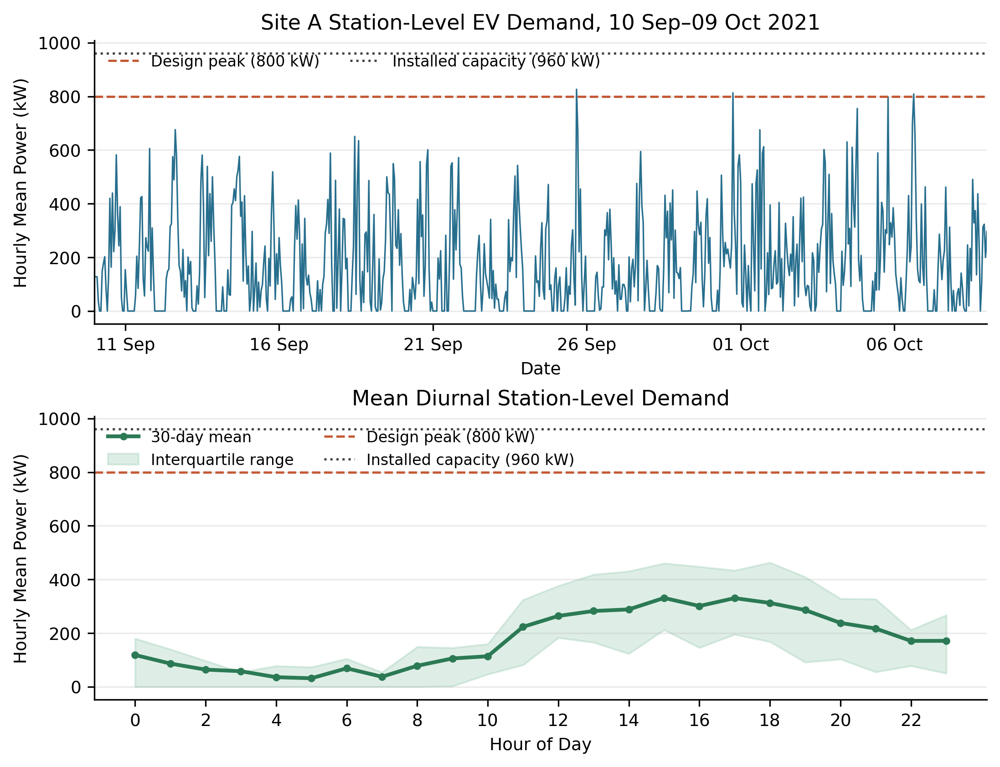
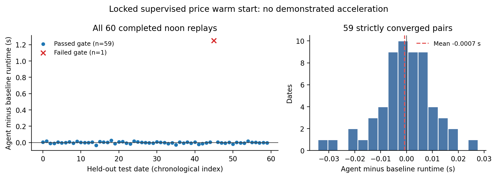
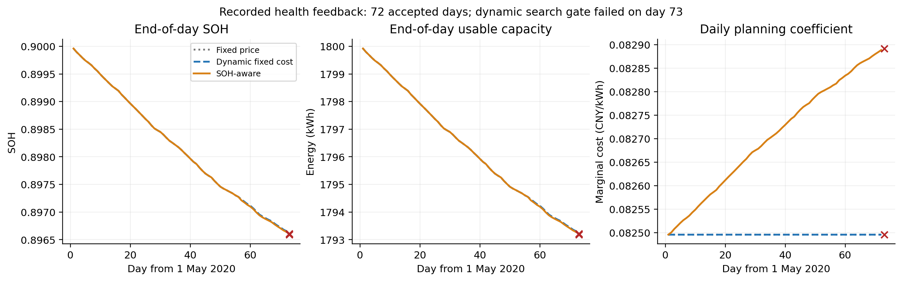
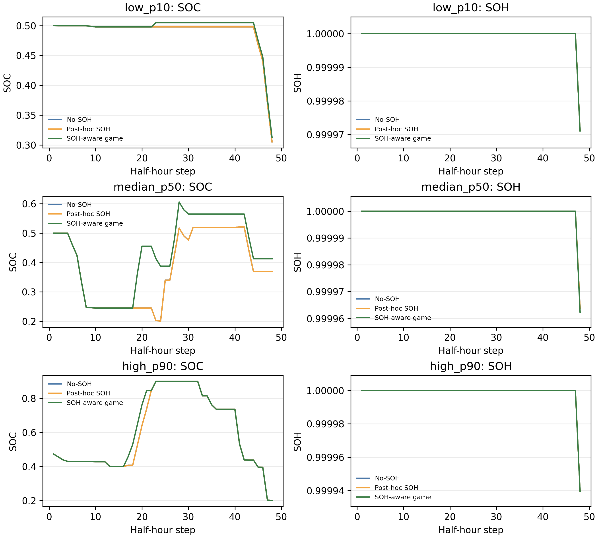
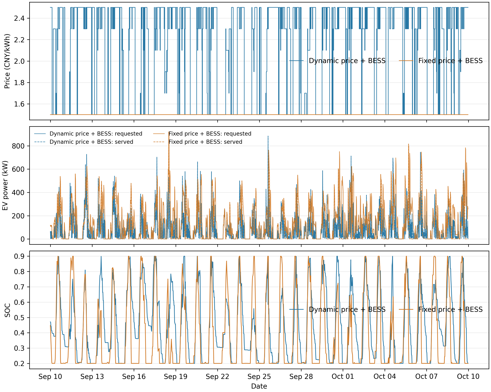
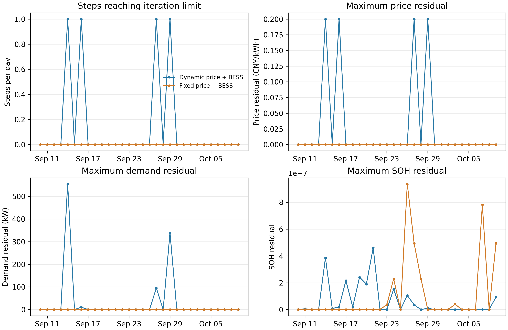
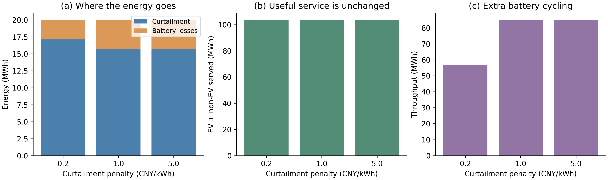
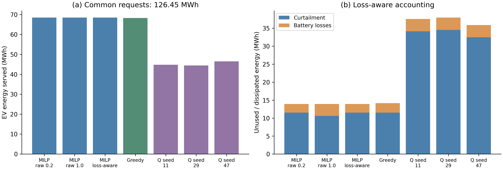

# 将电池SOH纳入高速公路孤岛充电微电网滚动主从定价与调度：可行性研究

修订日期：2026年11月18日。本版与同日英文稿同步，以SOH接入方法及其可行性证据为主线。图片保留英文，参考文献保留原文；CNY表示人民币元。连续实验采用72个通过日及第73天失败记录的最新审计。

## 摘要

本文提出将电池健康状态（SOH）纳入高速公路孤岛充电微电网滚动主从定价与储能调度的方法。SOH改变运营者的可用容量约束和边际退化成本，执行轨迹在日边界更新物理健康状态。可行性依据来自机制消融、能量与交付收入恒等式及连续状态传递检查，而非预设经济优势。冻结系统为400 kW光伏、100 kW风电、2000 kWh/800 kW储能及8×60 kW充电桩，采用日期匹配ERA5物理驱动。144个独立日消融中136例通过全部门槛、8例累计能量失败。计划90天的共同需求诊断中，两个动态组均有72个连续通过日，每组3456个半小时记录满足能量和SOC检查。SOH-aware组健康由0.900000降至0.896641，边际系数由0.082496升至0.082888元/kWh，显示跨日反馈确实生效。两个动态组均在第73天未通过坐标搜索停止判据，因此完整窗口求解可靠性尚未建立。连续诊断固定请求，只验证健康相关调度与核算，不能验证策略性价格响应或均衡。条件性模型价值增益不证明普遍盈利或寿命改善。现有证据支持在已通过测试范围内计算实现SOH耦合方法，并明确其收敛与部署边界。

**关键词：** 电动汽车充电；电池健康状态；动态定价；孤岛微电网；实际交付电量收入；气象驱动可再生发电

## 1. 引言

高速公路EV充电同时具有集中到站、停留时间有限及功率需求较大的特点。孤岛站点必须依靠可再生发电和电池储能满足需求，无法从外部电网购电。运营者因此需要联合决定各时段可供电量与向用户提供的电价。电价可改变模型中的充电请求和收入，电池调度则在时段间转移可再生电量。最终平衡既依赖需求假设，也依赖可再生能源利用率的核算边界。

电池健康引入了更慢的状态变量。充放电引起老化，老化降低可用容量并改变后续调度的经济后果。如果仅在调度后核算寿命成本，就无法将这种状态依赖反馈至运行决策；但细致的电化学老化模型又可能不适合反复进行电价搜索。可操作的折中方案是在调度中采用易计算的边际退化代理项，并在较慢时间边界根据执行轨迹更新健康状态。

EV主从定价[1]与孤岛微电网协调[2]为该方法提供基础，但实际控制器不能只按总收入评价。较高服务率可能来自电价压低了请求量，较低弃电可能来自储能消耗了更多能量，而完成的仿真也可能包含未达到既定不动点容差的决策。解释SOH的额外作用时必须区分这些情况。

本文的核心问题是：SOH能否在调度前进入运营者决策，并将执行后果一致传递至下一次决策。方法连接两个时间尺度：运行层电价响应与储能决策使用健康相关可行域和退化系数；每日执行SOC与吞吐量更新物理电池状态。SOH是运营者资产的状态，不是新增博弈主体；跟随者仍优化自身充电分配。健康通过储能可行性和成本间接改变运营者对候选电价的评价，不要求用户直接优化电池健康。

贡献包括：（1）将SOH接入滚动主从模型的容量与成本接口；（2）把执行调度连接至后续健康决策的状态传递与核算协议；（3）含失败案例的组件消融和连续账本可行性证据。本文检验声明假设下的模型实现与数值可执行性，不要求健康感知方案优于全部基准。学习辅助仅为附加诊断，不构成方法的核心贡献。

本文定位为可行性研究，尚未证明全局最优Stackelberg均衡、因果识别的电价响应或电池寿命预测。站点采用聚合模型，网络量在调度后评价。第2-5节介绍相关研究、数据、模型和求解方法，第6-7节介绍实验设计与结果，第8-9节给出讨论和结论。

## 2. 相关研究

### 2.1. 充电定价与微电网协调

Cheng等采用顺序Stackelberg博弈设计个性化、网络感知的充电电价[1]，为本文运营者与用户之间的交互提供启发。Singh等通过双层Stackelberg方法研究包含混合储能、孤岛约束和需求响应协调的直流微电网运行[2]。这些研究提供相关定价与协调背景，并不能验证本文实现中的行为系数或网络近似。本文处理的是单个孤岛站点、六档电价、聚合充电分配及日尺度健康转移。

EV需求不确定性下的运行调度也适用于换电等相邻基础设施[12]。确定性历史回放的局限在于：获得已观测需求曲线，不能消除未来到站不确定性，也不能识别其他电价下的反事实需求。本文交易数据集[3]提供观测基线，而反事实电价响应仍采用假设的情景关系。

### 2.2. 运行决策中的电池退化

如Hesse等的综述所示，固定式电池的设计与运行共同依赖应用要求、储能组件和老化因素[4]。老化机理[5]、电芯整体模型[6]、寿命评估模型[7]、电力市场中的循环老化成本[8]及日历老化研究[9]分别处理不同层次的问题。这些研究支持将调度内部的计算代理项与事后核算中的轨迹评价分开。

本文遵循这种分离，但实现远比已校准的电芯模型简单：循环老化采用吞吐量与每日SOC极差，日历老化采用平均SOC分段项，价值核算采用线性残值规则。这些方程属于实现假设，系数并非从上述论文中直接转用、且已针对本研究电池实测验证的参数。当前不含雨流循环分解、温度动态、化学体系辨识或实测寿命终点验证。

### 2.3. 滚动控制与学习

滚动时域优化只执行首个动作，并随状态变化重新求解。约束模型预测控制的稳定性与最优性理论[10]说明，采用滚动实现本身并不足以证明这些性质。本文控制器含离散电价搜索和外层需求-健康更新，收敛性必须通过实验检查，未提出闭环稳定性定理。

Q-learning[11]可通过重复交互学习策略，其效果取决于状态表示、动作、奖励、训练分布和执行约束。本文表格型控制器仅在检验现有优化器后用作探索性诊断，并非强化学习与数学优化的全面比较，也不是学习得到的定价均衡。

## 3. 系统与数据

### 3.1. 系统边界与参数

微电网由光伏（PV）、风电、电池储能系统（BESS）、8个充电桩及假设的非EV负荷组成，无外部能量输入。网络计算在储能母线设置参考电压节点，但该参考不构成电源；缺口仍计为未服务需求，剩余发电则弃用。

表1采用模型冻结清单中的二稿主配置：400 kW光伏、100 kW风电、800 kW/2000 kWh储能及8个60 kW充电桩，EV总服务功率上限为480 kW。早期历史图表采用800 kW/1200 kWh储能及8个120 kW充电桩，其轨迹在第7节作为独立的一稿诊断保留，不与二稿主案例合并。

**表1. 主要参数及其解释。**

| 参数 | 数值 | 解释 |
|---|---|---|
| 光伏/风电额定功率 | 400 / 100 kW | 可用出力曲线采用假设转换 |
| BESS功率/额定电量 | 800 kW / 2000 kWh | 模型冻结主配置 |
| 充电设施 | 8桩，每桩60 kW | 合计设备上限480 kW |
| 站点设计峰值 | 420 kW | EV并发设计参考量；假设p90同时性 |
| 非EV负荷 | 60 kW | 恒定负荷假设 |
| 初始SOC/SOH | 0.50 / 1.00 | 压力测试另行指定 |
| 规划SOC范围 | 0.10-0.90 | 终端SOC不低于0.20 |
| 执行SOC储备 | 0.20 | 严于规划下限 |
| 充电/放电效率 | 0.95 / 0.95 | 恒定转换效率 |
| 电价网格 | 1.5-2.5元/kWh，步长0.2 | 固定电价基准为1.5 |
| 弹性/参考电价 | 1.157 / 1.4元/kWh | 情景响应参数 |
| 调度步长/预测时隙数 | 0.5 h / 24 | 首时隙0.5 h，其余1 h |

### 3.2. 历史EV基线

数据来自Figshare公开数据集《中国高分辨率多维特征电动汽车充电交易数据集》第3版[3]。选择Site A作为主站点。清洗后的充电会话电量按会话持续时间分配至小时区间，正常会话电量构成基线。遵循作者对站点数据的解释，将历史序列视为单桩需求并乘以8映射为站点总需求。该映射是作者指定的解释，尚未经数据发布者独立确认，也不单凭充电桩标识推断实际设备数量。

基线反映当时运行条件下的观测活动，既不是无约束潜在需求，也不是六档未观测电价下的经验响应曲线。二稿每桩60 kW为设备约束，并不表示每个桩持续以60 kW运行；早期120 kW额定值属于一稿历史配置。利用率低时，历史小时平均功率可以保持较低水平。

低、中、高需求日期分别选择最接近正常日能量P10、P50、P90分位数的日期：2020年1月2日、2020年7月3日和2021年9月17日，对应站点映射基线为582.24、1545.04和3679.36 kWh/日。定价比较另取2021年9月10日至10月9日连续30天高能量窗口。该窗口是选择出的高需求时期，不是代表所有季节的随机样本。图1展示施加反事实电价响应前的观测需求。

**图1.** 所选30天窗口内Site A的观测站点需求，按作者指定的8桩映射汇总。设备与设计额定值作为参考线；基线需求不同于控制器产生的内生请求。

### 3.3. 历史可再生能源与预测假设

一稿光伏与风电输入采用重复典型日曲线，并按额定功率缩放。光伏峰值400 kW，风电低于100 kW额定功率。这些是可用发电假设，不是与交易日期匹配的实测出力或经验证预测。历史每日可再生电量4187 kWh，假设非EV负荷1440 kWh；这些实验未抽样预测误差分布。

数据接口循环使用当天24小时EV曲线填充前视窗口。因此实际SOC、SOH可以跨日传递，而预测仍重复当天，并未使用下一观测日。该确定性近似可能影响日末决策。原始A/B/C预测文件保留，但因其日期与EV功率尺度不匹配本历史站点配置，未用于本文。

### 3.4. 二稿按日期匹配的气象-出力转换

二稿按本地时间（中国标准时间UTC+8）将Site A需求日期与小时ERA5再分析数据连接。气象采用0.25度ERA5网格点，是站点空间代理而非现场仪表观测。原始GRIB元数据确认，`ssrd`为一小时太阳辐射累积量，有效时间戳表示该小时的**结束**。因此本地10:00-11:00调度使用有效时间为11:00的记录，两次半小时动作共享平均辐照度`G = ssrd/3600`，单位W/m²。可用光伏功率为`400 clip(G/1000,0,1)` kW，未计温度降额。100 m风矢量用于计算`v = sqrt(u100^2+v100^2)` m/s，并以小时起止风速均值近似调度小时风速。分段风机曲线规定：低于3 m/s为零，3-12 m/s按三次曲线爬升，12-25 m/s为100 kW，高于25 m/s为零。阈值与插值均为工程假设，两序列分别受冻结的400/100 kW额定值限制。当前缺少辐照度倾斜面转换、面板倾角、尾流、停机及站点专属风机校准。再分析数据是按日期匹配的物理驱动，不能视为经验证预测；预测能力需另做留出检验。实验记录网格点、时区转换、缺小时处理、气象文件校验值及确切公式。

## 4. 滚动定价与健康模型

### 4.1. 状态与时间表示

运行状态包括SOC、日尺度SOH、聚合未完成电量、上次执行电价和预测信息。运营者每半小时选择时域电价向量与储能计划，仅执行首个动作。预测有24个时隙，但首时隙0.5 h，其余23个各1 h，实际覆盖23.5 h。方程使用各时隙自身持续时间保留该区别。

聚合用户组表示当前柔性需求、未来小时需求及积压。未来用户组可在相邻时隙分配电量，下一小时组的可用时隙包含当前时隙。模型不追踪个体到站、桩分配、车辆SOC及离站保证。主配置当前柔性比例为1、初始积压为0，实现的积压更新使其持续为0，因此不能视为已验证的车辆排队模型。

### 4.2. 预测与跟随者响应

外层第k次迭代以此前执行电价初始化标量预测电价，并按恒弹性情景关系缩放EV基线功率：

\[
\widehat P_t^{(k)}=\widehat P_t^{base}(\bar p^{(k)}/p_{ref})^{-\epsilon}. \qquad (1)
\]

内层返回的电价使预测电价向时域平均电价更新。跟随者也依据构建预测时所用电价调整各组电量上限。组i的可用时隙为A_i、平均报价为p_i时，其有效上限为：

\[
\widetilde E_i=E_i^{max}(p_i/\bar p^{(k)})^{-\epsilon}. \qquad (2)
\]

给定电价向量，跟随者求解线性电量分配问题：

\[
\max_e\;\sum_i\sum_t(v_i-p_t)e_{i,t}. \qquad (3)
\]

电量非负，在可用窗口外为零，并受组功率与时隙时长乘积限制。各组总电量不超过有效上限，且不低于有效上限与指定最低电量的较小者。共享站点约束为：

\[
\sum_i e_{i,t}\leq (480-P_{EV,t}^{rigid})_+\Delta t_t. \qquad (4)
\]

正部算子表示括号内数值与零的较大值。本实验将各组估值均抬高至2.51元/kWh，高于最高电价，因此观测响应并非来自跨越支付意愿阈值，而主要来自电量上限关系、分配窗口和拥堵罚项。系数1.157是情景代理，并非经因果识别的站点弹性。

每小时后半小时还受到需求接口细节影响：当前请求等于缩放后的小时电量减去观测基线功率与已过时间的乘积后，取正部再除以0.5 h。扣除量依据原始基线，而非此前实际执行的反事实服务量。该聚合规则可能引入半小时不连续，是需求接口的一项局限。

### 4.3. 储能与运营者目标

h表示SOH，E_nom表示额定电量。SOH-aware规划使用E_nom乘以健康状态作为有效容量。独立日容量消融可在规划中使用额定容量、在执行中使用健康相关容量；连续匹配成本诊断则在所有组的规划和执行中均使用当前健康相关容量，动态组差异用于识别边际成本刷新及其后续状态路径效应。充、放电功率非负，通过二进制模式变量互斥，各自上限为800 kW。SOC转移为：

\[
s_{t+1}=s_t+\frac{(\eta_cP_t^{ch}-P_t^{dis}/\eta_d)\Delta t_t}{E_{nom}h}. \qquad (5)
\]

历史控制器与独立日诊断规划SOC为0.10-0.90、终端最低0.20，执行每步保留0.20储备，故规划放电可能被削减。连续高精度程序则在规划和执行中均使用0.20-0.90、终端最低0.20。上述协议差异分别记录，不合并解释。

设EV请求功率为q_t、非EV负荷为b_t、可再生功率为r_t、规划弃电为c_t，EV和非EV削减功率分别为u_t的EV分量与N分量。修正后的领导者采用：

\[
r_t+P_t^{dis}+u_t^{EV}+u_t^{N}=b_t+q_t+P_t^{ch}+c_t. \qquad (6)
\]

每个候选电价下，跟随者线性规划（LP）确定请求，混合整数线性规划（MILP）优化储能与负荷削减，电价搜索评价：

\[
J=\sum_t p_t(q_t-u_t^{EV})\Delta t_t-C_{deg}^{proxy}-C_{shed}-C_{curt}-C_{cong}. \qquad (7)
\]

退化代理项为边际成本乘以充放电总吞吐量。二稿主案例EV未服务罚值100元/kWh、非EV缺供罚值1000元/kWh，均为明确假设；弃电罚值仍为0.2元/kWh。二稿拥堵项按480 kW设备限制归一化，历史960 kW归一化仅保留为一稿诊断。该成本是规划代理，并非实测等待时间成本。电价爬坡罚项为零。

式（7）只对扣除规划EV未服务量后保留的电量计收入。一稿以请求电量计算候选收入并使用聚合缺供，因此不能将其规划利润重新解释为修正目标。网络损耗与更严格的SOC储备仍可能使执行偏离规划；事后报告收入始终按实际交付EV电量计算。

### 4.4. 日尺度健康与老化成本

SOH是日内的物理慢状态。暂估一步健康状态参与外层迭代，实际健康则在日边界依据执行轨迹更新一次。循环项使用每日吞吐量Q与SOC极差D：

\[
Q_d=\sum_{t\in d}|P_t^{BESS}|\Delta t_t,\quad D_d=\mathrm{clip}(s_{max}-s_{min},0.01,1). \qquad (8)
\]

\[
\Delta h_d=\frac{k_{cal}(\bar s_d)}{365}\frac{H_d}{24}+\gamma Q_dD_d^{\alpha-1}. \qquad (9)
\]

gamma为1.5e-8/kWh，alpha为1.5，H_d为观测小时数。平均SOC区间0.10-0.50、超过0.50至0.80、超过0.80至0.90、超过0.90至1.00，对应年度日历系数0.01、0.015、0.025、0.04。健康组转移在实现的组表示中施加该损失，不是电芯级电化学计算。

当前连续协议的轨迹老化与规划边际系数采用统一额定置换价值C_ref=2000000元（2000 kWh乘以1000元/kWh），残值导数为1/0.30。C_ref不再随可用容量二次缩减。日边界按输入物理健康刷新系数；历史外层变体另评价暂估健康。单电池组采用参考DOD=0.5与暂定低健康磨损乘数：

\[
c_{deg}(h)=\frac{C_{ref}\gamma(0.5)^{\alpha-1}}{0.30}\left[1+0.5\left(1-\frac{h-0.70}{0.30}\right)\right]. \qquad (10)
\]

该系数中的健康截断于0.70-1.00。历史不含SOH规划器使用0.05元/kWh，故早期消融混合系数选择与健康反馈。修正连续基准冻结SOH-aware初始系数，在SOH=0.90时为0.082495791元/kWh。各组轨迹老化统一估值且每日只扣除一次，仍属于模型评价而非实测老化。

### 4.5. 二稿目标与服务核算

每个持续`dt_t`小时的区间，EV收入为`price_t * EV_served_t * dt_t`元。模型可区分弃电与缺供时，调度目标使用交付EV电量；按请求电量计算的收入不能解释为已实现利润。EV未服务量按设备上限及执行层处理后的`EV_requested_t - EV_served_t`记录，非EV缺供单独核算。对照报告的净运行价值为实际交付收入减模型电池老化、EV与非EV缺供罚项及声明的运行成本，同时另报较窄的“收入减老化”以便与历史记录比较。所有kW到kWh换算显式使用区间时长。可再生弃电、电池转换损耗、网络损耗与终端储能变化共同进入能量恒等式。

二稿主配置遵循冻结清单：400 kW光伏、100 kW风电、800 kW/2000 kWh储能及8个60 kW充电桩（合计480 kW）。一稿采用800 kW/1200 kWh储能与960 kW EV上限，属于另一配置的历史诊断。二稿记录确切配置，不跨额定值合并结果。960 kW短窗口案例明确标为充电容量敏感性，储能仍为2000 kWh，不纳入主比较。修正领导者的非EV缺供罚值为max(1000，EV罚值的10倍)元/kWh，以在供需紧张时保留非EV优先级。这是建模偏好，并非观测福利估值，各组保持一致。

### 4.6. SOH如何进入主从决策

耦合含三个明确连接：第一，输入健康通过式（5）决定领导者SOC转移及可行域中的可用电池容量；第二，健康通过式（7）和（10）决定比较候选电价时扣除的边际吞吐成本；第三，执行轨迹通过式（8）-（9）更新健康，后续日求解接收该状态。仅事后计老化只实现核算，未实现前两个连接；仅保存SOH字段也不足以证明接入，必须确认求解器实际使用的容量或成本随之变化。

该方法属于健康参数化的滚动主从决策。SOH变化或调度改变均不意味着最优电价必须改变：刚性需求、约束、离散电价与执行适配器均可能使电价或服务保持一致。组件消融检验接口是否生效，连续回放检验状态与核算是否连通。价格响应均衡主张还需要固定请求回放之外的证据。

## 5. 求解与执行

### 5.1. 有限次电价-需求迭代

内层对离散电价向量执行坐标上升，每个候选调用跟随者LP与储能MILP。主实验每次外层迭代允许一轮坐标扫描。外层更新预测电价、请求及暂估健康，当电价、响应功率、SOH的最大变化分别不超过0.001，或达到20次迭代时停止。残差单位不同，其数值最大值是实现判据，不是无量纲均衡证书。另行记录预测电价不动点残差，但不纳入该内部停止判据。

单次坐标扫描不能证明电价向量已不存在获利偏离，跟随者分配也可能不唯一。因此“收敛步骤”只表示满足实现的外层判据。未收敛步骤保留标记，其动作仍进入轨迹；删除这些行不能修复其对后续状态的影响。

额外诊断对预测电价更新采用自适应阻尼，在保存的问题状态上允许最多40次迭代。残差变号或增长时降低阻尼系数，显著收缩后提高。这些是独立状态回放，不替代连续仿真。实现使用Pyomo，并通过appsi调用HiGHS。连续共同需求程序是另一诊断协议：采用日内逐步缩短的半小时完全轨迹预测，最多两轮坐标扫描，记录的接受条件是末两轮目标值绝对差不超过1e-6元。该目标停滞标记不同于历史外层电价-需求-SOH残差，也不能证明全部单边偏离已充分检查。

### 5.2. 算法1：滚动SOH耦合与执行

**输入：** 日期匹配EV/气象轨迹或声明预测；冻结设备、电价网格和罚值；初始SOC、完整电池组状态、求解预算与接受门槛。**输出：** 电价、请求、EV/非EV独立交付量、储能动作、传递健康/SOC、成本账本与失败标记。

1. 日边界接收前一执行日完整物理电池状态与SOC，由健康计算可用容量及边际系数；匹配固定成本消融则保留相同初始系数。

2. 每半小时组装声明时域与用户可用窗口。有限坐标搜索评价每个候选电价时，在上述容量和系数下求解跟随者分配及领导者储能/服务MILP。响应模型使用式（1）-（4）；共同需求诊断固定用户电量及可用时隙，以隔离健康-调度接口。

3. 记录实际采用的停止判据与迭代预算耗尽。历史外层用分量残差，连续诊断用末轮目标停滞；均不标为全局均衡证明。若启用辅助，锁定Agent只向相同搜索提供合法初始电价。

4. 经物理适配器只执行首个半小时动作。记录EV请求/交付、非EV缺供、电池和网络损耗、弃电及SOC。实际EV收入等于执行电价乘以交付kWh，保留规划与执行动作区别。

5. 日末依据执行SOC与吞吐量计算老化，更新完整电池状态，单列健康降低容量导致的储能重估。执行声明的置换规则，置换支出与运行价值分列。将更新状态与SOC传至下一日，不重置健康。

6. 按不变的能量、SOC及求解门槛检查。保留失败日及其状态，通过前缀不等于完整窗口验证。数值或搜索修复必须作为独立回放或新版本连续轨迹报告。

该方法无需学习Agent。第7节监督热启动与历史储能Q-learning仅为附加负结果诊断，不用于证明强化学习建立SOH可行性；训练、验证、测试边界另行报告。

### 5.3. 直流网络事后检查

首个储能指令先按物理限制截断。电阻型直流计算采用储能参考节点、0.4 kV基准及分别连接光伏、风电和负荷母线的三条0.005 Ω支路，评价电压、电流和网络损耗。这些是原型假设，并非实地测绘设施；调度后检查0.95-1.05 pu电压带。

出现缺口时，执行层先增加可行放电，再削减柔性EV服务，记录剩余刚性缺口。出现盈余时，先弃光、再弃风，随后调整过量电池充电。执行层并不对每次盈余独立优化储能。电压与支路电流约束未嵌入电价优化，支路热额定值缺失。该层支持核算与诊断，不能支持网络安全合规声明。

## 6. 实验设计与核算

### 6.1. 消融与电价比较

No-SOH在规划中排除SOH；Post-hoc SOH采用相同调度但事后扣除老化；SOH-aware规划包含健康相关容量与边际成本。所有方案具有相同物理老化机制。为公平比较，三者均计算收入减轨迹老化，不能将No-SOH毛收入与其他净值直接比较。

代表日分别从SOC=0.50、SOH=1、零积压、电价1.5元/kWh独立开始。高需求压力测试初始SOH=0.80。30天动态/固定电价比较从匹配状态出发，各组内部连续传递SOC、SOH、上次电价及实现的积压。固定电价1.5元/kWh。两种实验均非随机化的实证电价试验。

指标包括请求、服务、未服务电量，服务率、弃电、吞吐量、老化成本、电价计数、状态终点、残差及运行时间。“收入减老化”不含资本回收、其他运行成本及未服务需求福利损失。不同内生请求总量始终与服务率同时报告。

### 6.2. 共同需求能量审计

首个控制实验固定原动态组的请求及各源日期输入SOC/SOH。按弃电罚值0.2、1、5元/kWh求解独立48时隙日调度，规划SOC最低0.10、终端最低0.20，不执行网络层。这90个日调度是独立回放，不是新连续轨迹。因优化器削减聚合需求，主服务指标为EV与非EV总供能；非EV优先拆分仅用于额外核算，不是独立优化优先级约束。

共同功率边界上的电池转换损耗为：

\[
L_{bat}=\sum_t\left[(1-\eta_c)P_t^{ch}+(1/\eta_d-1)P_t^{dis}\right]\Delta t_t. \qquad (11)
\]

可再生电量等于EV与非EV服务电量、弃电、电池损耗及储能变化之和；执行网络时另加网络损耗。在服务量与储能终点匹配时，将弃电转为电池损耗不会增加有用交付。

### 6.3. 损耗感知目标与条件性Agent测试

第二个基准固定30天全部观测站点映射需求，每天将SOH重置为1，SOC范围0.20-0.90，日初与日末均固定0.50。与原控制器不同，EV和非EV缺供分开赋予100与1000元/kWh罚值。四类完全信息日MILP比较弃电原罚值0.2、1、5，以及将权重1施加于弃电与式（11）损耗之和的方案；边际吞吐成本一致。

仅在原罚值从0.2提高至1未使窗口内EV服务或弃电加损耗改善超过1 kWh时，协议才进入Agent训练。该阈值是明确的实践标准，不是统计显著性检验；仅降低弃电不满足条件。

Agent通过表格型Q-learning仅控制储能功率。状态为半小时时刻、15档SOC、7档当前请求、7档未来6小时净能量。9个指令为-800、-400、-200、-100、0、100、200、400、800 kW。奖励为EV缺供、非EV缺供、吞吐成本、弃电与损耗加权和的负值再除以1000。折扣为1，学习率max(0.03, visits^-0.6)，epsilon从0.6降至最低0.03。三个种子各训练6000个日回合，采样自2021年9月10日前609个观测日期，测试日期不进入训练。

指令投影至电池边界与终端可达域，但不能保证非EV服务。连续动作贪心规则采用相同投影。MILP使用全天完全信息，Agent只获压缩的6小时特征，动作集也不同。损耗感知MILP最小化与Agent奖励相同的代理阶段成本，作为该确定性基准的离线成本界。比较只能诊断该Agent，不能对所有在线学习与优化方法排名。此基准不包含学习电价或学习SOH博弈。

### 6.4. 四臂配对测试与不确定性协议

二稿预设四组：固定电价+BESS；动态电价+固定边际退化成本；SOH-aware动态博弈；Agent辅助SOH-aware动态博弈。各组使用相同物理EV请求、日期匹配气象、半小时步长、初始SOC/SOH/积压、设备容量、终端规则与损耗核算。固定边际成本匹配给定初始SOH下SOH-aware组的初始系数。另分别关闭容量反馈、成本反馈，并匹配初始系数以识别机制。价格响应需求另作情景，不决定主共同需求排名。

先以短窗口检查能量恒等式（绝对残差不超过1e-6 kWh）、收入积分、EV/非EV缺供分类及收敛。多日测试拟覆盖P10/P50/P90与初始SOH 1.00、0.90、0.80、0.70，每单元至少3个日期或独立种子。每个匹配日期与状态报告净值、EV交付、弃电、弃电加电池及网络损耗、老化成本和墙钟时间的配对差值。按单元报告收敛/未收敛/失败数量；独立日期足够时计算95%配对自助法区间，否则给出全部个体差值，不作置信声明。低SOH、供需紧张及风光富余分层由输入状态和气象-需求平衡事先确定。保留负结果与未收敛结果。完整四臂结论需要已训练锁定的Agent及日期互斥测试集。

### 6.5. 可行性的操作性定义

分三个层次评价。**模型接入：** SOH必须改变声明的求解容量或目标系数，每日执行动作必须反馈下一健康状态。**数值执行：** 记录满足能量/收入恒等式、SOC边界、状态传递及适用停止门槛。模型允许缺供并如实报告，数值可行不等于满足站点全部需求。**博弈求解：** 策略响应或均衡主张需要具有电价响应的跟随者及充分检查的领导者搜索。当前主要证据覆盖前两个层次，刚性共同请求轨迹不能建立第三层。全局收敛、热安全、实测老化校准及实时部署均超出现有证明范围。

## 7. 结果

**二稿证据状态。** 第7.0-7.0.4节给出修正短窗、附加Agent、连续诊断及可行性证据边界。第7.1-7.5节图表是历史一稿诊断，保留供追溯，不用于修订后四臂策略排名。尤其历史半小时收入在用于修订净值前需要显式按区间积分。

### 7.0. 修正后的日期匹配短窗与实验状态

ERA5原始`ssrd`消息的`stepRange`为一小时，有效时间戳表示小时结束。最初日期匹配程序误将同小时有效值用于随后调度小时。因此早先24小时与三个日期文件保留追溯，但不再作为有效气象驱动结果。修正程序使用调度小时结束时的辐射记录，风速取两小时边界样本平均；同一小时的两次半小时动作共享太阳辐射均值。公开站点记录未给出已核实坐标，因此ERA5网格点仅为空间代理。

对齐后的4时隙检查选Site A于2021年5月4日北京时间10:00-12:00，初始SOC=0.50、SOH=0.90。固定电价+BESS、动态固定成本、SOH-aware三组共享124.4754 kWh物理EV请求并全部交付，EV缺供与弃电均为零。模型可再生输入78.5340 kWh，EV与非EV有用交付合计244.4754 kWh，电池转换损耗8.7866 kWh、网络损耗1.0049 kWh、储能变化-175.7329 kWh，能量残差8.53e-14 kWh。初始边际系数已匹配且SOH仅在日边界变化，故两个动态组轨迹相同。固定收入186.7131元与动态311.1885元仅体现同一刚性请求下的价格算术差异，不能证明定价收益。锁定Agent另按下节正午一小时测试。

SOH×需求矩阵采用对齐输入并分文件保存检查点，各案例每天独立重置，只能诊断初始SOH容量效应，不能单独证明连续多日寿命效益。SOH在日边界更新，故日内退化成本反馈处于静止状态。早期SOH=0.90/P10配对中，容量开关使规划储能功率最大变化19.09 kW，但执行适配器将两计划重平衡为同一物理动作与服务总量。因此分别记录规划与执行差异；适配器下零执行差异不证明容量反馈本身无效。能量、收敛、数据门槛失败均保留，并排除于仅通过案例汇总之外。不对已替代的三个日期文件给出置信区间或排名。

续跑完成全部144个独立日案例：136个通过全部门槛，8个未通过预先规定的累计能量门槛；无BRI未收敛标记，冻结源码/输入审计通过。完整匹配集含66对容量开关和68对成本开关。成本配对执行动作与老化差异为零，符合日内SOH固定的预期。28对容量案例的规划差异被执行层掩盖。最大规划储能功率差250.31 kW，最大执行差246.27 kW，但完整容量配对EV服务绝对差均低于1.2e-13 kWh。这些有目的选取的诊断支持实现检查，不支持总体区间、一般策略排名、连续寿命效益、全局Stackelberg最优或网络安全声明。求解耗时含主机暂停，不是独立CPU基准。

### 7.0.1. 锁定Agent热启动测试（附加）

时间划分包括2020年357个训练日、2021年1-8月241个验证日；排除早期诊断已查看的9-10月61天，预留11-12月60天测试。只在验证集选择邻居数。其中一个测试日曾在独立锁定的微型检查点冒烟测试中查看，未依据结果改方法，故日期互斥但并非完全未经查看。保留确切日期清单与模型检查点。

监督k近邻检索Agent由2020年357个训练日的714个正午电价时隙标签训练。教师两时隙电价在353天为[1.5, 1.5]元/kWh，4天为[1.5, 1.7]。241个验证日上，1邻居平均教师利润差0.00340元，3或5邻居均为零；预先约定同分选较小邻居数，因此测试前锁定3邻居。Agent只向未修改的SOH-aware BRI提供合法初始电价向量，属于监督模仿，不是强化学习或独立物理控制器。

留出评估尝试2021年11-12月全部60日，初始SOH=0.80、SOC=0.50。每日执行正午两个半小时，预测时隙为0.5与1.0 h，因此是执行一小时回放而非全天。59个配对日期同时通过求解器与外部预测电价残差门槛。其两组平均EV交付25.8769 kWh、收入38.8154元、吞吐量117.2911 kWh、老化14.6370元，EV缺供与弃电均为零；报告精度下全部物理经济配对差值为零。12月16日虽有内部收敛标记，两组预测电价残差均为0.05元/kWh，超过预设0.001门槛。原记录保留，排除于通过案例均值。

60个完成日期上，非Agent与Agent平均求解执行时间分别2.7653 s和2.7855 s。基准/Agent时间比0.9928；10000次重采样、7日循环移动块自助法给出的95%区间为[0.9781, 1.0007]，未证明加速。区间只反映一个锁定模型条件下的日期变化，不覆盖训练种子与重复硬件计时不确定性。完整流程1249.3 s，其中训练标签生成255.1 s。教师价格近乎恒定可解释热启动增益有限。该测试证明第四臂接口可运行，未证明全天或寿命改善。

**图7.** 60个留出正午日期的Agent减基准求解执行时间差。红叉标记12月16日，两组均未通过严格预测电价收敛门槛；右图仅含59个通过配对。日期间小幅时间差不足以证明加速。

### 7.0.2. 连续三天状态传递诊断

对齐的2021年5月1-3日诊断采用相同日期EV请求及ERA5出力，比较固定电价+BESS、动态固定退化成本、SOH-aware动态博弈。各组初始SOC=0.50、SOH=0.90，主配置冻结。不同于独立日矩阵，每组将完整电池组状态与SOC传至次日。SOH在连续日边界由0.9000000降至0.8999313、0.8998766、0.8998263，各组可用容量均下降。合计0.2440 kWh的储能容量重估量与电池及网络损耗分开记录。固定成本组初始系数0.0824958元/kWh保持不变，SOH-aware每日刷新，第2天为0.0825039元/kWh。无置换。

三天各组均交付请求1177.1500 kWh中的1156.9830 kWh EV电量，非EV缺供18.3637 kWh，轨迹老化1158.0542元，弃电加电池/网络损耗3907.8905 kWh。两个动态组物理轨迹与模型运行价值均相同（-19380.77元）；与固定组（-20525.69元）的差异来自同一固定请求下的电价收入2880.39元与1735.47元。这是含缺供罚项的模型价值，不是站点实测现金利润。运行时间依次11.55 s、3136.20 s、3156.38 s。SOH-aware成本反馈改变了系数，却未改变该轨迹动作或服务。

原始9条组日记录均未通过绝对日能量残差1e-6 kWh门槛，三日残差分别1.214e-6、2.063e-6、1.472e-6 kWh，各组相同；动态BRI无未收敛标记。独立高精度执行回放沿用原动作和日初状态、不重优化，将残差降至3.3e-10 kWh以下，EV交付、收入、老化、SOC和功率不变，仅每日约1-2e-6 kWh数值弃电变化。由此将失败定位于逐步求解停止误差累积，但不能追溯性地将原运行改判通过。结果属于机制与核算诊断，不是合格策略排名或寿命证据。

### 7.0.3. 计划90天诊断：通过前缀与停止门槛失败

预设块为2020年5月1日至7月29日，初始SOC=0.50、SOH=0.90，主容量冻结。2026年11月18日审计发现固定组90天通过，两个动态组各有72个连续通过日（5月1日至7月11日）。二者均将第73天7月12日记录为失败并停止：本地02:00在两轮扫描预算内未满足末轮目标停滞判据；两组当日能量残差仍通过，分别2.86e-11与2.88e-11 kWh。因此失败属于搜索停止门槛，并非能量不守恒；不能宣称完整90天动态验证。第73天保留且不纳入通过前缀总量，第74-90天未在这些运行中执行。

72个通过配对日中，三组EV请求8359.71 kWh、交付7406.38 kWh、未服务953.33 kWh。两个动态组实际交付收入均17631.69元。SOH-aware减动态固定成本为：非EV缺供-11.81 kWh，弃电加电池/网络损耗-11.83 kWh，轨迹老化+94.04元，置换支出差为零。模型运行价值分别-13653476.31元与-13665199.25元。+11722.94元差值依赖假设的1000元/kWh非EV缺供估值，两总值均大幅为负，不是项目现金利润。

对同一物理结果重估，零非EV罚值时差-91.39元，5元/kWh时-32.32元，10元/kWh时+26.75元，盈亏分界7.74元/kWh。该单轨迹敏感性不是总体置信区间或已识别福利收益，核心可行性结论不依赖条件性价值优势。

72个匹配日记录时间：固定441.58 s、动态固定成本160570.63 s、SOH-aware 160701.28 s，动态差+130.65 s。主机暂停与并发负载影响记录，不能推断受控加速或已具半小时部署能力。这些值替代旧69天时间快照，不与旧快照合并。

各动态组通过前缀含3456个半小时，SOC为0.20-0.90，终端SOC失败为零，最大日能量残差2.33e-10 kWh。原型电压重构0.99623-1.01219 pu，位于0.95-1.05 pu内，无相对电压优势。所有步骤均因未设置支路载流额定值而热安全未验证。数值执行通过不表示无中断满足需求或实测网络安全。

### 7.0.4. SOH接口确实生效的依据

账本审计未发现相邻日完整状态或SOC传递不一致；逐步收入等于执行电价乘以实际交付EV电量，误差为零；日初可用容量等于2000乘以SOH，误差为零。可用`scripts/audit_soh_feasibility.py`复算，源哈希与失败时间戳保存在`soh_feasibility_audit_20261118.json`。

SOH-aware的72天通过路径中，健康0.900000000降至0.896640771，可用容量1800.0000降至1793.2815 kWh。日边际系数0.082495791升至0.082888297元/kWh；匹配动态基准保持0.082495791元/kWh。系数与式（10）误差不超过2.78e-17元/kWh，说明健康实际影响下次求解容量和成本，并非只附在输出表格中。连续对照在共同健康相关容量下隔离成本刷新；独立日容量开关消融另显示容量能够改变规划动作。

**图8.** 连续诊断记录的每日SOH、可用容量与边际退化系数。曲线展示各组72个通过日，红叉表示两个动态组保留的第73天失败记录。固定组完成90天，此处仅显示相同日期。系数刷新可直接观察，后续搜索门槛失败限制可靠性结论。

式（1）-（7）的响应模型说明健康进入主从模型的位置，历史响应运行显示实现可返回电价与调度。但连续测试固定各时隙请求，用户电量无法策略性响应价格，搜索停滞标记不能证明响应博弈均衡。因此现有证据支持模型接入及限定范围数值可执行性，尚未建立稳健价格响应收敛、整个90天动态完成、寿命收益或部署收益。

### 7.1. 代表日SOH效应

9个代表日运行均完成48步且满足实现的外层停止判据。这是实现诊断，不是一般收敛或均衡证明。No-SOH与Post-hoc按定义共用轨迹。表2给出日比较，图2显示SOC和日健康转移。

**表2. 初始SOH=1的独立代表日消融。电量单位kWh，老化成本单位元。**

| 日期类别 | 规划器 | 请求 | 交付 | 终端SOC | 老化成本 |
|---|---|---:|---:|---:|---:|
| 低需求P10 | No-SOH / Post-hoc | 515.23 | 515.23 | 0.3051 | 115.47 |
| 低需求P10 | SOH-aware | 515.23 | 515.23 | 0.3123 | 115.68 |
| 中需求P50 | No-SOH / Post-hoc | 1367.23 | 1340.97 | 0.3690 | 144.26 |
| 中需求P50 | SOH-aware | 1367.23 | 1367.23 | 0.4127 | 150.34 |
| 高需求P90 | No-SOH / Post-hoc | 1802.08 | 1745.48 | 0.2000 | 242.02 |
| 高需求P90 | SOH-aware | 1802.08 | 1745.48 | 0.2000 | 242.02 |

中需求日SOH-aware增加服务26.26 kWh，同时增加老化6.08元；收入减老化为1900.51元，对照共同轨迹为1867.20元。吞吐量由1019.81升至1130.38 kWh。这些是特定情景的一日差异，服务改善伴随更高模型磨损，不证明一般健康感知优势。低、高需求日服务不变。低、中需求电价保持1.5元/kWh，高需求方案出现1.5、2.1、2.5元/kWh。

**图2.** 独立低、中、高需求日期的SOC与日末SOH。No-SOH与Post-hoc重合源于相同调度，SOH在物理日边界变化。

SOH=0.80高需求压力测试完成，但SOH-aware达到20次上限，最大需求残差662.21 kW；No-SOH与Post-hoc满足判据且轨迹相同。SOH-aware结果作为失败诊断保留，不纳入性能主张。

### 7.2. 30天有限迭代电价比较

各电价组完成1440个半小时决策。动态组模型服务率及收入减老化较高，但绝对服务较低、弃电较多（表3），其请求也显著较低。因两组并非服务同一内生请求，且动态总值包含4个未收敛步骤，此结果是描述性有限迭代比较，不是策略优越证据。

**表3. 30天结果。动态总值包含4个外层未收敛步骤。**

| 指标 | 动态电价+BESS | 固定电价+BESS |
|---|---:|---:|
| EV请求（MWh） | 61.7198 | 114.3664 |
| EV交付（MWh） | 58.5683 | 67.1275 |
| EV未服务（MWh） | 3.1514 | 47.2389 |
| 服务/请求（%） | 94.89 | 58.70 |
| 收入减老化（千元） | 126.5671 | 94.9018 |
| 可再生弃电（MWh） | 20.1604 | 11.2697 |
| 电池吞吐量（MWh） | 51.4151 | 51.6671 |
| 平均电价（元/kWh） | 2.1664 | 1.5000 |
| 达到外层上限步数 | 4 | 0 |

六档动态电价均出现：2.5元/kWh占743时段（51.60%），1.5元/kWh占391（27.15%），中间档占306（21.25%）。电价虽变化，但边界集中显著。这是有限离散搜索的输出，不能验证弹性代理或最优性。图3显示电价、内生EV功率与SOC。

标记决策位于9月14日15:30、16日18:30、27日12:30、29日14:30。最大需求残差554.50 kW，最大电价残差0.20元/kWh，固定组无此问题。两组均达到0.20储备。图4按分量报告残差。

完成日累计计算时间动态13.00 h、固定228.0 s，不含中断的部分日和停机。固定组无需多档搜索，因此不是复杂度匹配比较。动态耗时对直接半小时在线部署构成实际限制。

**图3.** 执行电价、EV请求与服务及SOC。电价诱导不同请求；动态组含4个外层迭代上限步骤。

**图4.** 每日外层循环审计。各残差单位不同；日文件完成不表示全部电价-需求迭代均收敛。

### 7.3. 弃电与有用电量

9月10日端到端一日测试同时改变电价和请求。原罚值由0.2提高至5时，弃电704.80降至1.67 kWh，服务2053.87升至2760.86 kWh，请求2053.87升至2925.88 kWh，服务率由100%降至94.36%。说明罚值可改变电价-需求轨迹，但不能单独识别储能利用率，也不能验证5元/kWh的经济合理性。

共同需求回放提供控制。90个日MILP均报告最优终止，最大能量残差约1.2e-9 kWh。表4和图5说明仅观察弃电会产生误导。

**表4. 使用原动态请求与输入状态的逐日回放，电量单位MWh。**

| 原罚值（元/kWh） | EV+非EV交付 | 弃电 | 电池损耗 | 弃电+损耗 | 吞吐量 |
|---|---:|---:|---:|---:|---:|
| 0.2 | 103.7477 | 17.1191 | 2.8932 | 20.0123 | 56.5029 |
| 1.0 | 103.7477 | 15.6535 | 4.3585 | 20.0120 | 85.0940 |
| 5.0 | 103.7477 | 15.6535 | 4.3585 | 20.0120 | 85.0948 |

罚值0.2升至1时，弃电减少1.4655 MWh，损耗增加1.4653 MWh，有用服务不变，剩余约0.264 kWh变化对应储能差异。按非EV优先核算，两个权重EV交付均60.5547 MWh、非EV缺供7 kWh；权重5时分别60.5507 MWh和3 kWh。吞吐量增约50.6%，轨迹老化6431.56升至7893.97元。因此表面8.56%弃电改善几乎全部转为耗散，并未增加有用交付。

**图5.** 受控回放区分弃电与电池转换损耗。EV加非EV服务总量不变，额外循环将弃电转为耗散。使用源日期输入状态，回放调度并非连续执行轨迹。

仅在不同时段顺序充放电即可产生该现象，无须同时充放电。高弃电罚值奖励吸收盈余，而吞吐成本可能不足以抵消奖励。假设效率下完整理想循环的每单位吞吐损耗约0.05125；SOH=1时实现的边际成本约0.04243元/吞吐kWh，故原弃电罚值盈亏分界约0.828元/kWh。计算假设有用服务与终端能量不变且无新增约束绑定。因此该条件下罚值1可奖励耗散循环，0.2不会；联合惩罚弃电与转换损耗可去除该激励。

### 7.4. 损耗感知调度与Agent诊断

第二基准共同请求126.4518 MWh，全部优化器方案服务68.4979 MWh。原罚值0.2升至1，弃电11.5151降至10.6120 MWh，损耗2.3970升至3.3000 MWh，二者之和保持13.9121 MWh。损耗感知目标恢复弃电11.5151、损耗2.3970 MWh，吞吐量46.7719 MWh，而原罚值1为64.3932 MWh。该目标避免额外循环，但未超越原低罚值最优方案的交付量。

有用电量未改善触发Agent训练。图6与表5保留全部种子及贪心参考。这些是独立日调度诊断，并非新的定价-健康连续轨迹。

**表5. 留出调度诊断。请求126.4518 MWh，各方法每日初末SOC均0.50。**

| 方法 | EV交付（MWh） | 弃电+损耗（MWh） | 吞吐量（MWh） | 非EV缺供（kWh） |
|---|---:|---:|---:|---:|
| MILP，原罚值0.2 | 68.4979 | 13.9121 | 46.7719 | 0 |
| MILP，原罚值1 | 68.4979 | 13.9121 | 64.3932 | 0 |
| MILP，损耗感知1 | 68.4979 | 13.9121 | 46.7719 | 0 |
| 投影贪心 | 68.2451 | 14.1649 | 51.7054 | 0 |
| Q-learning，种子11 | 44.8310 | 37.6010 | 67.0159 | 22 |
| Q-learning，种子29 | 44.4388 | 37.9892 | 66.9578 | 18 |
| Q-learning，种子47 | 46.5371 | 35.8859 | 65.9912 | 13 |

**图6.** 共同需求调度诊断。Agent采用3个种子、压缩预测特征和9个指令，MILP有完全信息。电池端点匹配，但信息与动作不同。

Agent服务44.44-46.54 MWh，低于MILP与贪心，且非EV缺供13-22 kWh。独立回放在8种方法、30个日期保存11520条半小时记录。最大状态残差约2.6e-9 kWh、功率平衡残差低于1.2e-10 kW，电池边界与终端等式通过；这些检查不能抵消服务失败。该Agent不适合替代优化器，但负结果不能推广至所有学习方法。

### 7.5. 附加求解器诊断

2021年9月14-16日采用原罚值5进行三天自适应阻尼运行。两组均完成144步、日SOC/SOH端点连续。动态请求/服务7.2864/6.5188 MWh，固定10.4722/6.4489 MWh，弃电分别1.2522/1.4044 MWh。动态仍有6个外层上限步骤，最大需求残差5.609 kW，固定无此问题。总量仍仅作描述。

最多40次迭代时，6个孤立输入状态回放中3个满足现有判据：2021-09-14 13:30（24次）、2021-09-14 14:30（22次）、2021-09-16 01:30（22次）。其余3个达到上限：2021-09-14 22:30（需求残差1.46171 kW、电价0.2元/kWh、预测电价0.005632元/kWh）；2021-09-14 23:30（0.0118762 kW、0元/kWh、0.001021元/kWh）；2021-09-16 18:30（5.60904 kW、0.2元/kWh、0.004449元/kWh）。各回放第20次需求残差与源记录一致。增加迭代帮助部分状态，却未解决全部标记状态。早期动作变化会改变后续状态，故孤立状态达标不能证明多日路径已修复。保留完整迭代与独立预测电价残差；原30天及三天结果均不覆盖、不改标为收敛。

## 8. 讨论与局限

### 8.1. SOH效应解释

代表日证据显示日尺度健康与边际退化可通过控制器传递并改变调度，但未证明一致的健康、服务或利润优势。中需求日改善伴随更多吞吐与磨损，另两日无服务变化。无健康规划器固定系数不同，因此比较混合系数选择与健康反馈。更清晰的机制研究应匹配初始边际系数，并分别消融容量降额与成本反馈。

72天通过前缀提供直接状态传递与系数刷新证据，但第73天搜索门槛失败限制数值可靠性；条件性价值仍由非EV罚值主导，EV服务未增加。低SOH失败表明，健康约束更重要的区间也可能更难有限迭代。不能由3个SOH=1案例或单一90天季节块推断可靠低健康运行与寿命收益；尚未证明寿命置换节省。连续寿命研究前应先诊断第73天停止失败，并在独立版本连续路径验证搜索修复，不改判原失败。之后完成90天块，再在匹配初始SOH（0.70、0.80、0.90、1.00）下运行预先指定的时间连续季节块，各条件至少3个独立起始日或气象年。连续传递SOH、SOC、置换状态和成本，预先规定置换阈值，保留全部失败步骤，并在独立块间报告配对结果与不确定性。老化转移尚未校准，即使完成365天仿真，也只支持模型内寿命推断，不是已验证的电池寿命预测。

### 8.2. 可再生利用与EV优先级

原动态组对较小内生请求具有更高服务率；同期固定组绝对EV交付更多、弃电更少。单独任一观察都不能对共同用户的策略排名。EV优先主张需要共同需求、明确离站义务，以及对已接受和被电价抑制需求的联合核算。

能量审计显示弃电几乎被转换损耗一比一替代。损耗感知目标消除该激励，但不创造新服务机会。固定请求和终端储能时，守恒严格限制其他算法的改善空间。价格诱导的需求变化必须与储能效率分开评价。

本基准Agent未优于简单规则且发生服务失败。更丰富学习可研究预测处理或执行加速，但属于另一问题；学习本身不会修正错误奖励、识别弹性或增加可行能量预算。当前证据支持保留优化与修正核算，尚不支持宣称Agent增益。

### 8.3. 数据与实现局限

站点聚合依作者解释，强实证站点结论需要独立来源确认。弹性是假设，估值均高于报价，半小时规则混合基线观测与反事实预测。模型无个体队列和离站信息。重复可再生曲线与逐日循环预测忽略气象及跨日不确定性。

历史高能量窗口与设备容量在开发中已查看，不能视为完全未触碰的外部验证。一稿储能Agent训练日期虽互斥，测试窗口也用于模型诊断；三个历史种子是描述性结果，不是部署置信区间。2021年11-12月热启动测试日未进入训练或验证，其中一天在独立锁定微型检查点冒烟测试中查看，但未依据结果改方法。新测试只含单训练种子与短正午执行，其时间区间不覆盖训练随机性或重复机器计时。老化缺少化学体系、温度校准和循环计数；网络参数为假设、热额定值缺失。

规划与执行储备规则不同。一稿候选收入在缺供前按请求计算且缺供聚合；二稿领导者已按规划交付EV电量和独立缺供类别核算。网络约束仍在电价优化之外。有限迭代、单轮坐标扫描、混合单位停止及未纳入预测电价一致性，均阻止均衡认证。完成输出文件并不消除这些局限。

## 9. 结论

本文提出在滚动主从充电定价与储能调度中向运营者一侧接入SOH的方法。健康在调度前决定可用容量与边际退化成本；执行SOC与吞吐量更新日尺度物理状态，并传至下一次求解。因此SOH同时是运行输入和核算输出。贡献是明确的耦合及可审计执行，而非强化学习控制器或健康感知必然增利。

证据支持限定范围的可行性结论。144例独立日矩阵136例通过、8例能量失败；容量开关可改变规划动作，日内固定健康不能识别跨日成本反馈。共同请求连续诊断提供72个动态连续通过日，每组3456个半小时满足SOC/能量检查，实际收入积分一致、状态传递无断裂，SOH-aware容量与边际成本随健康按规定变化。两个动态任务第73天均未通过坐标搜索停止门槛，完整窗口可靠性未证明；固定请求也使该诊断不能建立策略电价响应或均衡收敛。

通过前缀没有EV交付或收入增益，条件性模型价值差在非EV罚值低于7.74元/kWh时反转，并伴随更高老化。电压检查只适用于假设原型，热安全未验证。方法在已通过测试范围内可计算实现；全局均衡、无中断服务、经校准寿命改善和实时部署均超出现有证据。下一项方法验证应对有限搜索进行可追溯修复和重测，再以匹配信息、固定物理容量开展连续价格响应实验。附加Agent测试尚无加速证据，也不是该方法可行性的必要条件。

## 数据与代码可用性

公开交易数据来自Figshare第3版[3]，许可CC BY 4.0。本地复现包含对齐短窗JSON、锁定Agent检查点及时间划分、全部60个留出原始记录、当前实验汇总、矩阵检查点、执行脚本、图源及参考元数据。旧24小时及三个日期气象文件因ERA5区间修正标为已替代。该包尚非公开代码发布。投稿前需作者确认身份、单位、资助、贡献与利益冲突声明。

## 参考文献

[1] Cheng, Rui; Liu, Gengming; Liu, Wenxia; Shi, Qingxin; Chen, Qifang. A personalized network-aware price design for electric vehicle charging using a sequential Stackelberg game. Applied Energy 2025, 381, 125145. DOI: 10.1016/j.apenergy.2024.125145.

[2] Singh, Abhishek; Kumar, Alok; K.A., Chinmaya; Maulik, Avirup. DC microgrid operation with hybrid energy storage considering islanding constraints and demand response coordination: A bi-level Stackelberg game approach. Journal of Energy Storage 2024, 102, 113913. DOI: 10.1016/j.est.2024.113913.

[3] Yuanshi Zhang; Tongxin Xu; Tao Chen; Qinran Hu; Hongrui Chen; Xukun Hu; Zilv Jiang. A high-resolution electric vehicle charging transaction dataset with multidimensional features in China. Figshare, version 3, 2025. DOI: 10.6084/m9.figshare.28182251.v3. CC BY 4.0.

[4] Hesse, Holger; Schimpe, Michael; Kucevic, Daniel; Jossen, Andreas. Lithium-Ion Battery Storage for the Grid—A Review of Stationary Battery Storage System Design Tailored for Applications in Modern Power Grids. Energies 2017, 10, 2107. DOI: 10.3390/en10122107.

[5] Vetter, J.; Novák, P.; Wagner, M.R.; Veit, C.; Möller, K.-C.; Besenhard, J.O.; Winter, M.; Wohlfahrt-Mehrens, M.; Vogler, C.; Hammouche, A. Ageing mechanisms in lithium-ion batteries. Journal of Power Sources 2005, 147, 269-281. DOI: 10.1016/j.jpowsour.2005.01.006.

[6] Schmalstieg, Johannes; Käbitz, Stefan; Ecker, Madeleine; Sauer, Dirk Uwe. A holistic aging model for Li(NiMnCo)O2 based 18650 lithium-ion batteries. Journal of Power Sources 2014, 257, 325-334. DOI: 10.1016/j.jpowsour.2014.02.012.

[7] Xu, Bolun; Oudalov, Alexandre; Ulbig, Andreas; Andersson, Goran; Kirschen, Daniel S. Modeling of Lithium-Ion Battery Degradation for Cell Life Assessment. IEEE Transactions on Smart Grid 2018, 9, 1131-1140. DOI: 10.1109/tsg.2016.2578950.

[8] Xu, Bolun; Zhao, Jinye; Zheng, Tongxin; Litvinov, Eugene; Kirschen, Daniel S. Factoring the Cycle Aging Cost of Batteries Participating in Electricity Markets. IEEE Transactions on Power Systems 2018, 33, 2248-2259. DOI: 10.1109/tpwrs.2017.2733339.

[9] Keil, Peter; Schuster, Simon F.; Wilhelm, Jörn; Travi, Julian; Hauser, Andreas; Karl, Ralph C.; Jossen, Andreas. Calendar Aging of Lithium-Ion Batteries. Journal of The Electrochemical Society 2016, 163, A1872-A1880. DOI: 10.1149/2.0411609jes.

[10] Mayne, D.Q.; Rawlings, J.B.; Rao, C.V.; Scokaert, P.O.M. Constrained model predictive control: Stability and optimality. Automatica 2000, 36, 789-814. DOI: 10.1016/s0005-1098(99)00214-9.

[11] Watkins, Christopher J. C. H.; Dayan, Peter. Q-learning. Machine Learning 1992, 8, 279-292. DOI: 10.1007/bf00992698.

[12] Nayak, Dhyaan Sandeep; Misra, Shamik. An operational scheduling framework for Electric Vehicle Battery Swapping Station under demand uncertainty. Energy 2024, 290, 130219. DOI: 10.1016/j.energy.2023.130219.
